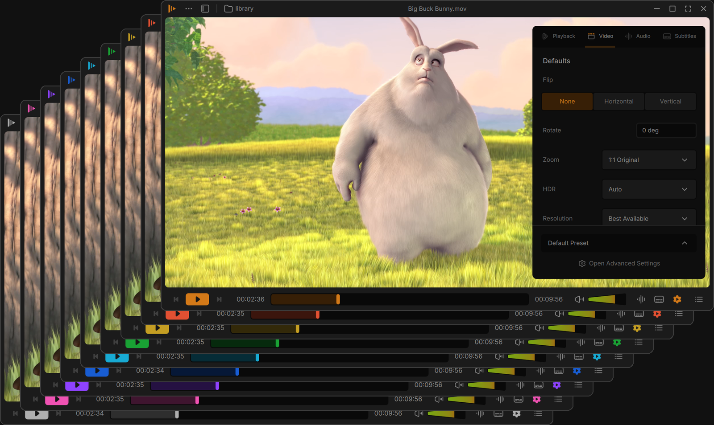

<p align="center">
  
</p>

<h1 align="center">Cone Player</h1>

<p align="center"><strong>Juxtopposed's VLC redesign, built on a real VLC 4 fork. Not a skin.</strong></p>

<p align="center">
  <a href="https://github.com/StickyGonzales/vlc-redesign-juxtopposed/releases/latest"></a>
  
  <a href="COPYING"></a>
  <a href="https://creativecommons.org/licenses/by/4.0/"></a>
  
</p>

<p align="center"></p>

| | |
|---|---|
| <br>**Player.** Thin floating bars that get out of the way, and subtitles that stay readable. | <br>**Settings sidebar.** Video, audio, subtitles and playback, next to the picture. |
| <br>**Library.** Home, videos, music and playlists, with a mini player. | <br>**Settings.** Plain categories instead of VLC's preference tree. |

## Why Cone Player

- **A real VLC 4 fork.** VLC's own engine, codecs and formats, with a new interface. Not a skin or a theme.
- **Her whole design, checked.** Every screen and control is built from Juxtopposed's Figma file and video, and compared with them side by side on Windows.
- **Fixes bugs in VLC 4 itself**, such as the time jumping ahead after a pause at a changed speed, a start-up freeze with some MKV files and a crash when picking the Spectrometer visualizer.
- **Installs next to your VLC** instead of replacing it: its own settings, its own file associations, and your VLC stays as it is.

## Themes and accent colors

Dark and light themes and nine accent colors: the default orange and eight more. Pick them in the first start or in Settings > General; the whole player changes at once.

<p align="center"></p>

## Download

Get it from the [latest release](https://github.com/StickyGonzales/vlc-redesign-juxtopposed/releases/latest) (Windows 10 and 11, 64-bit). What changed: [release notes](https://github.com/StickyGonzales/vlc-redesign-juxtopposed/releases/latest).

| Download | File | How |
|---|---|---|
| **Installer** (recommended) | `coneplayer-1.1.0-win64.exe` | Run it and follow the pages. Adds a Start menu entry, "Open with" for your media and an uninstaller in Settings > Apps. |
| **Portable zip** | `ConePlayer-1.1.0-win64.zip` | Unzip it anywhere and run `Cone.exe`. Nothing is installed, and settings stay in the `portable` folder next to `Cone.exe`. |

**Linux (beta):** [Cone Player 1.1.0 for Linux](https://github.com/StickyGonzales/vlc-redesign-juxtopposed/releases/tag/linux-v1.1.0-beta) as an AppImage or a portable tarball (64-bit, glibc 2.39 or newer). It was tested in a Linux sandbox only: real sound and GPU video have not been tested on real Linux hardware yet.

<details>
<summary>Windows says "Windows protected your PC"</summary>

The files are not code-signed yet, so Windows SmartScreen may warn the first time you run them. Choose **More info**, then **Run anyway**. Each release lists the SHA-256 of both files, so you can check a download with `Get-FileHash` in PowerShell.

</details>

## Features

**Player**
- **Floating bars.** The top bar and the control bar float over the video and hide when the mouse rests. Ctrl+\ hides them on demand.
- **Seek bar.** Thumbnails while you hover, an optional audio waveform, and the subtitle timeline for timing subtitles by eye.
- **Cone volume.** A volume slider shaped like the cone, up to 200 %.
- **Queue, bookmarks and chapters** in one sidebar. Ctrl+B adds a bookmark at once.
- **On-screen messages** name the key you pressed, so a stray key is easy to spot.
- **Autoplay next episode** (a Cone extra, not part of Juxtopposed's design). In a show folder an Up Next card counts down to the next episode. Off, ask for each show, or always, in Settings > Playback.

**Subtitles**
- **Tracks popup** for audio and subtitle tracks, embedded and external.
- **Add Subtitles** for a whole folder at once, matched to each episode, from your computer or from OpenSubtitles.
- **Sync sliders** for subtitle delay and speed, and subtitles that move above the control bar while it shows.

**Library**
- **Home, Videos, Music, Playlists, Network and Recent**, with real thumbnails and watched state.
- **Mini player** with the queue attached. Drag files from the library into the queue.
- **Network streams.** Paste an IPTV m3u link and it becomes a playlist.
- **Pins** in the library sidebar for quick access.

**Settings**
- **Settings sidebar** with Playback, Video, Audio and Subtitles tabs, including speed, sleep timer, equalizer and audio visualizers.
- **Per-show presets.** One preset per show keeps its subtitle, audio, video and playback settings.
- **A new Settings window** with plain categories, search and short explanations behind the info icons.
- **Dark and light themes** and 9 accent colors, picked during the first start and changed live.

**Customize**
- **Customize Player.** Drag buttons into, out of and around the bars.
- **Profiles** keep a layout together with its settings. Switch between them from the main menu.

<details>
<summary>Keyboard shortcuts</summary>

VLC's default shortcuts all work. The most used ones, and the ones Cone Player adds:

| Key | Action |
|---|---|
| Space | Play / pause |
| F, Esc | Fullscreen, leave fullscreen |
| Shift / Alt / Ctrl + Left or Right | Jump back or ahead (very short, short, medium) |
| Ctrl+Up, Ctrl+Down, M | Volume up, down, mute |
| N, P, S | Next, previous, stop |
| +, -, = | Faster, slower, normal speed |
| V, B | Next subtitle track, next audio track |
| G, H | Subtitle delay down, up |
| J, K | Audio delay down, up |
| E | Next frame |
| Ctrl+B | Add a bookmark (Cone Player) |
| Ctrl+\ | Hide or show the bars (Cone Player) |
| Ctrl+O, Ctrl+N | Open a file, open a network stream |
| Ctrl+P | Settings |
| Ctrl+Q | Quit |

Every shortcut can be changed in the Keyboard Shortcuts window (main menu).

</details>

<details>
<summary>FAQ</summary>

**Why "Cone Player" and not VLC?** "VLC" and the traffic cone icon are VideoLAN's trademarks, so this app has its own name and icon. Underneath it's VLC.

**Does it change how media plays?** No. Playback and codecs are VLC's own. The work is in VLC's interface, plus a few small, separate fixes in VLC's core.

**Does it replace my VLC?** No. Both run side by side, each with its own settings. Cone Player never takes a file type away from VLC: you choose in "Open with".

**Does it update itself?** No, but it tells you. Once a day Cone Player asks GitHub for the latest release and shows a small notice when a newer one is out (Settings > General > Check for updates turns it off). New versions are on the [Releases page](https://github.com/StickyGonzales/vlc-redesign-juxtopposed/releases). A newer installer updates an installed Cone Player and keeps its settings.

**How do I remove it?** Settings > Apps > Cone Player > Uninstall. It asks before deleting your settings. For the zip, delete its folder.

**How do I build it?** Fork this repository, enable Actions and run the **build-windows** workflow with the brand set to `public`. It uses VideoLAN's own Windows toolchain image and build script.

</details>

<details>
<summary>Known issues (1.1.0)</summary>

- On a few HEVC files with many B-frames, switching the audio track can still stall the video, and quitting can then take 5 seconds before Cone Player ends itself. Settings and the resume position are kept.
- Closing Cone Player sometimes takes up to 5 seconds after its window disappears, until it ends itself (settings and the resume position are kept). A file double-clicked during those seconds now opens in a new window.
- Pressing M (mute) shows only the mute icon, without "Pressed M".
- The Subtitle Duration Factor slider is hidden for now: in this VLC 4 engine it made ASS / SSA subtitles disappear. It comes back once it works.
- Rarely, Windows may log a background error after closing Settings. Nothing visible happens.
- New Cone Player texts are in English in every language for now.
- The portable zip doesn't show up in Windows' "Open with" menu. Use the installer for that, or drag files onto Cone Player.
- Like VLC, Cone Player keeps a small graphics cache in `%LOCALAPPDATA%\Cone\cache`, also when run from the zip.

</details>

<details>
<summary>Juxtopposed's Figma design</summary>

Cone Player is built from Juxtopposed's [VLC Redesign Figma file](https://www.figma.com/community/file/1691465999134370980/vlc-redesign) and her [video](https://youtu.be/ERFeOgqk324): every size, color and spacing comes from her frames. Two of them:

| | |
|---|---|
| **Settings**<br> | **Keyboard Shortcuts**<br> |

</details>

## Coming next

- **Linux.** A Linux build follows as its own release.
- **1.1** brings **Autoplay next episode**, a Cone extra: when an episode of a show folder ends, an "Up next" card counts down to the next one. Cone extras are features beyond Juxtopposed's design, and they are always marked that way.

Found a bug? Open an [issue](https://github.com/StickyGonzales/vlc-redesign-juxtopposed/issues).

## Credits

- **Design:** ["VLC Redesign" by Juxtopposed](https://www.figma.com/community/file/1691465999134370980/vlc-redesign) ([video](https://youtu.be/ERFeOgqk324)), [CC BY 4.0](https://creativecommons.org/licenses/by/4.0/). Changes were made to fit it to VLC.
- **Based on [VLC media player](https://www.videolan.org/vlc/)** by VideoLAN and its contributors. Cone Player is GPLv2 or later like VLC (libVLC LGPLv2.1 or later), and all its source is here.
- **Fonts:** Inter and DM Mono, SIL Open Font License.
- **Films in the screenshots** (Blender Foundation open movies, [CC BY 3.0](https://creativecommons.org/licenses/by/3.0/)):
  - *Sintel*, © copyright Blender Foundation | [durian.blender.org](https://durian.blender.org/)
  - *Big Buck Bunny*, © copyright 2008, Blender Foundation | [www.bigbuckbunny.org](https://peach.blender.org/)
  - *Tears of Steel*, (CC) Blender Foundation | [mango.blender.org](https://mango.blender.org/)
- **Built by [StickyGonzales](https://github.com/StickyGonzales)** with [Claude](https://claude.ai/code).

Cone Player is an independent project, not affiliated with or endorsed by VideoLAN or Juxtopposed. VLC, VLC media player and VideoLAN are trademarks of the VideoLAN non-profit. Details in [CREDITS.md](CREDITS.md).

---

# About VLC

*VideoLAN's original README follows.*

# VLC media player

**VLC** is a libre and open source **media player** and **multimedia engine**,
focused on **playing everything**, and **running everywhere**.

**VLC** can play most multimedia files, discs, streams, devices and is also able to
convert, encode, **stream** and manipulate streams into numerous formats.

VLC is used by many over the world, on numerous platforms, for very different use cases.

The **engine of VLC** can be embedded into 3rd party applications, and is called *libVLC*.

**VLC** is part of the [VideoLAN project](https://videolan.org) and
is developed and supported by a community of volunteers.

The VideoLAN project was started at the university [École Centrale Paris](https://www.centralesupelec.fr/) who
relicensed VLC under the GPLv2 license in February 2001. Since then, VLC has
been downloaded **billions** of times.

## License

**VLC** is released under the GPLv2 *(or later)* license.
*On some platforms, it is de facto GPLv3, because of the licenses of dependencies*.

**libVLC**, the engine is released under the LGPLv2 *(or later)* license. \
This allows embedding the engine in 3rd party applications, while letting them to be licensed under other licenses.

# Platforms

VLC is available for the following platforms:
- [Windows] *(from 7 and later, including UWP platforms and all versions of Windows 10)*
- [macOS] *(10.10 and later)*
- [GNU/Linux] and affiliated
- [BSD] and affiliated
- [Android] *(4.2 and later)*, including Android TV and Android Auto
- [iOS] *(9 and later)*, including AppleTV and iPadOS
- Haiku, OS/2 and a few others.

[Windows]: https://www.videolan.org/vlc/download-windows.html
[macOS]: https://www.videolan.org/vlc/download-macosx.html
[GNU/Linux]: https://www.videolan.org/vlc/#download
[BSD]: https://www.videolan.org/vlc/download-freebsd.html
[Android]: https://www.videolan.org/vlc/download-android.html
[iOS]: https://www.videolan.org/vlc/download-ios.html

Not all platforms receive the same amount of care, due to our limited resources.

**Nota Bene**: The [Android app](https://code.videolan.org/videolan/vlc-android/) and
the [iOS app](https://code.videolan.org/videolan/vlc-ios/) are located in different repositories
than the main one.

# Contributing & Community

**VLC** is maintained by a community of people, and VideoLAN is not paying any of them.\
The community is composed of developers, helpers, maintainers, designers and writers that want
this open source project to thrive.

The main development of VLC is done in the C language, but this repository also contains
plenty of C++, Obj-C, asm and Rust.

Other repositories linked to vlc are done in languages including Kotlin/Java [(Android)](https://code.videolan.org/videolan/vlc-android/),
Swift [(iOS)](https://code.videolan.org/videolan/vlc-ios/), and C# [(libVLCSharp)](https://code.videolan.org/videolan/libvlcsharp/).

We need help with the following tasks:
- Coding
- Packaging for Windows, macOS and Linux distributions
- Technical writing for the documentation
- Design
- Support
- Community management and communication.

Please contribute :)

We are on IRC. You can find us on the **#videolan** channel on *[Libera.chat]*.

[Libera.chat]: https://libera.chat

## Contributions

Contributions are now done through Merge Requests on our [GitLab repository](https://code.videolan.org/videolan/vlc/).

CI and discussions should be resolved before a Merge Request can be merged.

# libVLC

**libVLC** is an embeddable engine for 3rd party applications and frameworks.

It runs on the same platforms as VLC *(and sometimes on more)* and can provide playback,
streaming and conversion of multimedia files and streams.


**libVLC** has numerous bindings for other languages, such as C++, Python and C#.

# Support

## Links

Some useful links that might help you:

- [VLC web site](https://www.videolan.org/vlc/)
- [Support](https://www.videolan.org/support/)
- [Forums](https://forum.videolan.org/)
- [Wiki](https://wiki.videolan.org/)
- [Developer's Corner](https://wiki.videolan.org/Developers_Corner)
- [VLC hacking guide](https://wiki.videolan.org/Hacker_Guide)
- [Bugtracker](https://code.videolan.org/videolan/vlc/-/issues)
- [VideoLAN web site](https://www.videolan.org/)

## Source Code sitemap
```
ABOUT-NLS          - Notes on the Free Translation Project.
AUTHORS            - VLC authors.
COPYING            - The GPL license.
COPYING.LIB        - The LGPL license.
INSTALL            - Installation and building instructions.
NEWS               - Important modifications between the releases.
README             - Project summary.
THANKS             - VLC contributors.

bin/               - VLC binaries.
bindings/          - libVLC bindings to other languages.
compat/            - compatibility library for operating systems missing
                     essential functionalities.
contrib/           - Facilities for retrieving external libraries and building
                     them for systems that don't have the right versions.
doc/               - Miscellaneous documentation.
extras/analyser    - Code analyser and editor specific files.
extras/buildsystem - Different build system specific files.
extras/misc        - Files that don't fit in the other extras/ categories.
extras/package     - VLC packaging specific files such as spec files.
extras/tools/      - Facilities for retrieving external building tools needed
                     for systems that don't have the right versions.
include/           - Header files.
lib/               - libVLC source code.
modules/           - VLC plugins and modules. Most of the code is here.
po/                - VLC translations.
share/             - Common resource files.
src/               - libvlccore source code.
test/              - Testing system.
```
