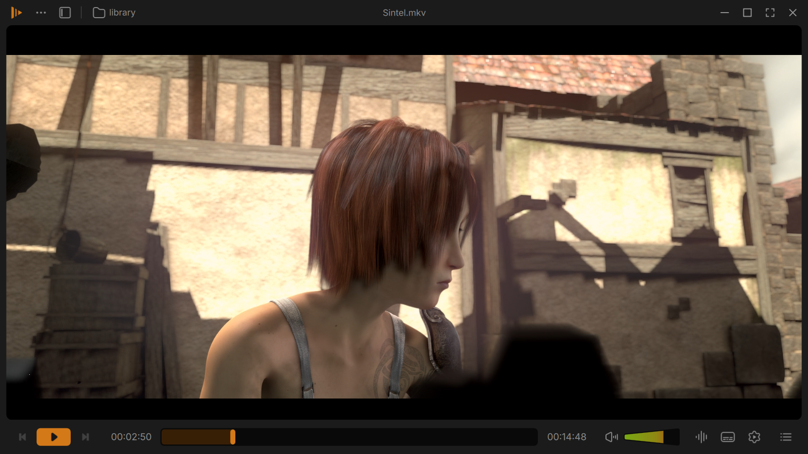
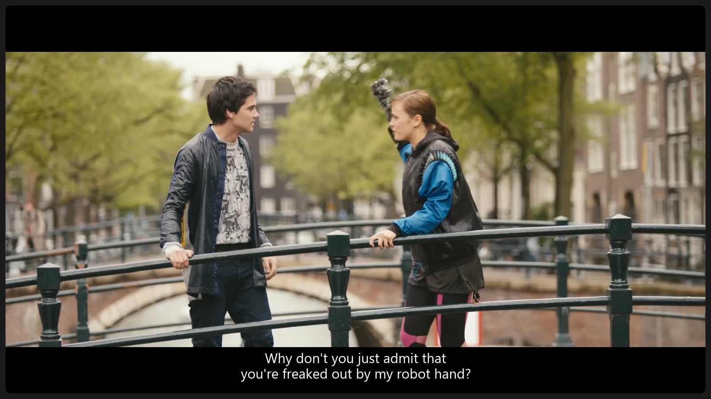
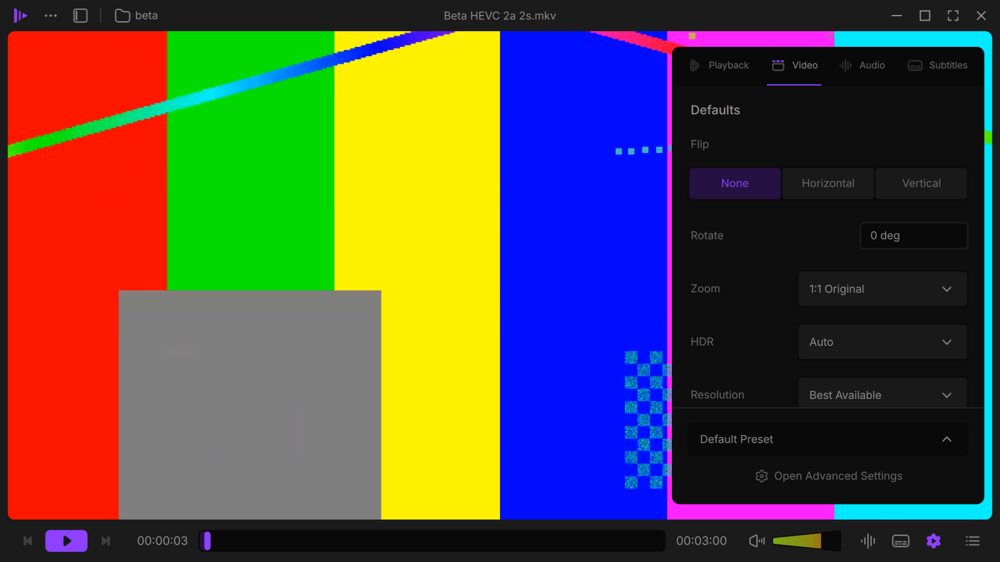
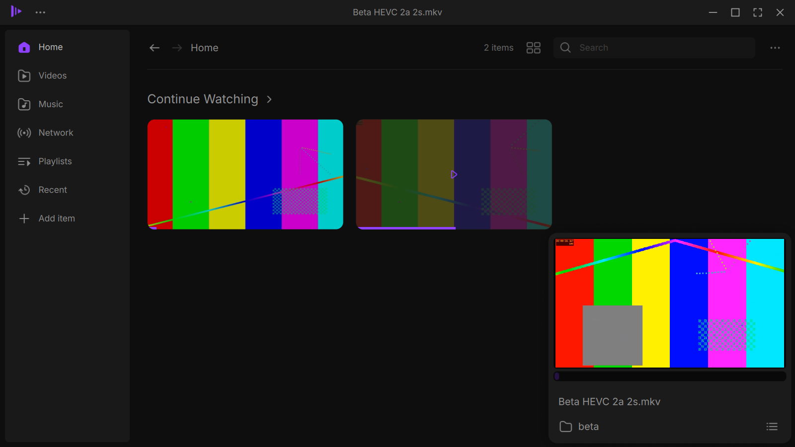
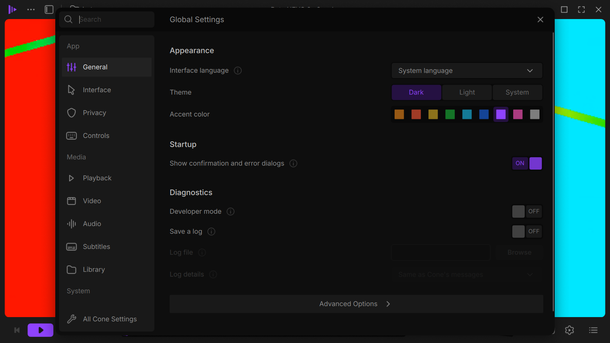
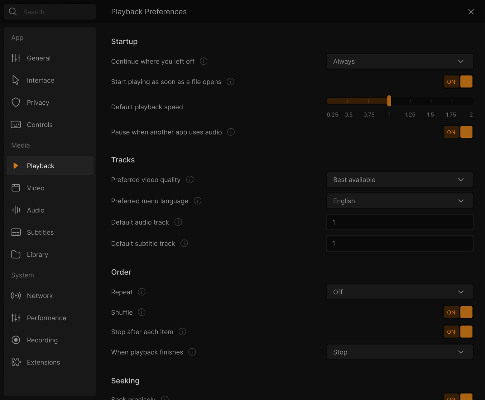
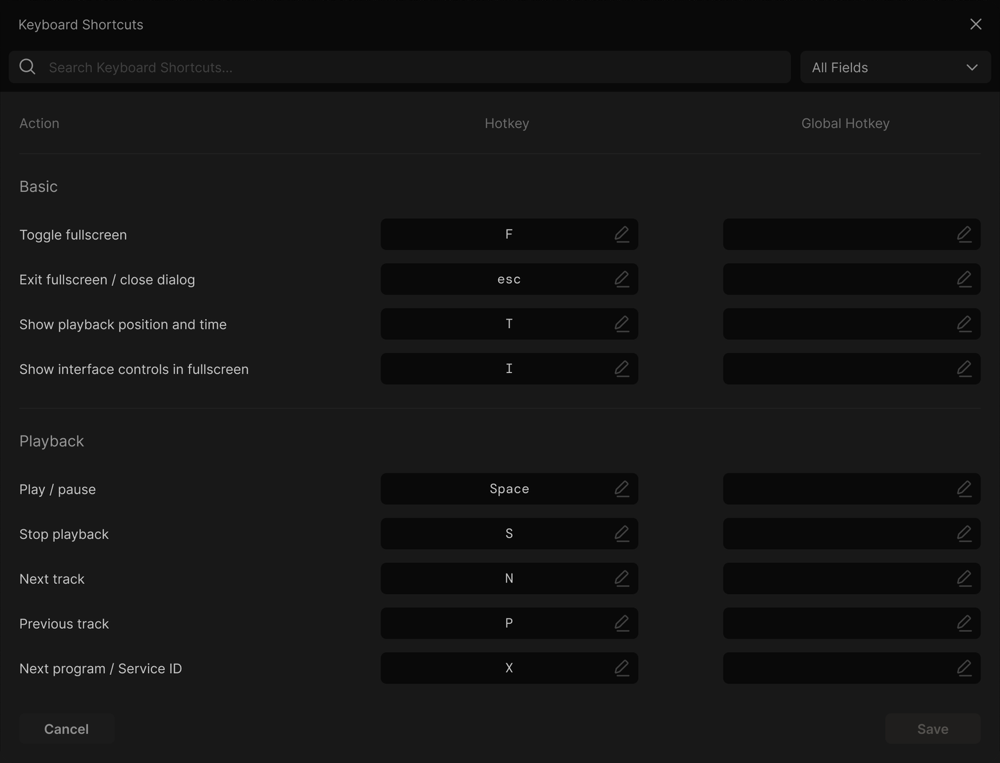

# Cone

**Juxtopposed's redesign on a real VLC 4 fork, not a skin.** Cone is VLC media player with her whole redesign on top: new player, sidebars, library, settings and onboarding. Same VLC engine underneath, under its own name so it can sit next to your regular VLC.



<sub>This image is a frame of Juxtopposed's Figma design, which Cone implements. Screenshots of Cone itself are below.</sub>

## Download

**[Cone 0.2.0 beta](https://github.com/StickyGonzales/vlc-redesign-juxtopposed/releases/tag/v0.2.0-beta)** is out.

1. Grab `Cone-0.2.0-beta-win64.zip` (Windows 10 / 11, 64-bit).
2. Unzip it anywhere and run `Cone.exe`. Nothing gets installed.
3. Your settings stay in the `portable` folder next to `Cone.exe`. Your installed VLC isn't touched, and both can run side by side. Coming from 0.1.0 beta? Copy its `portable` folder over to keep your settings.

It's a beta built on VLC 4 development code, so expect rough edges. Found a bug? Open an [issue](https://github.com/StickyGonzales/vlc-redesign-juxtopposed/issues).

**Linux:** coming. An installer for Windows comes later too.

## What's in it

- The redesigned player: floating control bar and top bar, seek bar with thumbnails, cone volume up to 200 %, tracks popup with embedded and external tracks
- A settings sidebar (Playback, Video, Audio, Subtitles) with per-show presets, sleep timer, speed and subtitle sync sliders
- Queue, bookmarks (Ctrl+B) and chapters, the new main and right-click menus, Keyboard Shortcuts and the new Settings
- A library with Home, Videos, Music, Playlists and Recent, a music view and a mini player
- Customize Player and profiles, onboarding, dark and light themes, 9 accent colors
- Subtitles move above the control bar while it shows
- Its own settings folder, its own entry in the Windows volume mixer and its own single-instance name, so it never takes over an installed VLC

## New in 0.2.0 beta

- A subtitle timeline on the seek bar: every subtitle line is a block you can drag to sync subtitles by eye
- On-screen messages show the key you pressed ("Pressed C")
- An "Additional command line options" field in Settings
- Equalizer preset icons drawn like the Figma design, and a link button for the crop filter
- "All Cone Settings" (VLC's full preferences) in Cone's look, and no file name over the video when a film starts
- Fixes: a video freeze with subtitles, Cone sometimes not quitting (a stuck quit now ends by itself after 5 s, with your settings saved), Escape closes the library, and the beta 1 issues with the About dialog, the light theme line and external subtitle names

Full list: [release notes](https://github.com/StickyGonzales/vlc-redesign-juxtopposed/releases/tag/v0.2.0-beta).

## Known issues (0.2.0 beta)

- With an audio visualizer on (for example Spectrometer), switching the audio track turns the visualizer window white.
- Picking the Spectrometer visualizer can, rarely, crash Cone.
- After a long session with many seeks and track switches on some HEVC (x265) videos, quitting can take 5 seconds. Settings and the resume position are kept.
- Pressing M (mute) shows only the mute icon, without "Pressed M".
- Rarely, Windows logs a background error after closing Settings. Nothing visible happens.
- New Cone texts are in English in every language for now.
- The app says 0.2.0; "beta" is only in the file names.
- The installer comes later; this beta is the portable zip only.
- The portable zip doesn't show up in Windows' "Open with" menu yet. Drag files onto Cone, or use "Choose another app" and browse to `Cone.exe`.
- Like VLC, Cone keeps a small graphics cache in `%LOCALAPPDATA%\Cone\cache`, even when run from the zip.

## Screenshots

Cone 0.1.0 beta on Windows, with generated test media and the purple accent.

| | |
|---|---|
| **Player**<br> | **Settings sidebar**<br> |
| **Library and mini player**<br> | **Settings**<br> |

### The design being built

Juxtopposed's Figma frames, the source for every size, color and spacing in Cone.

| | |
|---|---|
| **Player**<br> | **Home**<br> |
| **Library and mini player**<br> | **Compact library**<br> |
| **Settings**<br> | **Customize Player**<br> |
| **Onboarding**<br> | **Keyboard Shortcuts**<br> |
| **Light theme**<br> | |

## Cone extras (not part of Juxtopposed's design)

Features Cone adds beyond Juxtopposed's design (in neither her video nor her Figma file) are listed here, each marked as a Cone extra. They are not part of the betas or 1.0: each is built on its own branch and arrives after 1.0, starting with 1.1.

| Cone extra | Status | What it does |
|---|---|---|
| Autoplay next episode ("Up Next") | Planned for 1.1 | When an episode of a show folder ends, an "Up next" card counts down to the next episode. Off / Ask for each show / Always in Settings > Playback; single videos, recordings, clips and music are never treated as shows. Plan and designs: [UP_NEXT_PLAN.md](https://github.com/StickyGonzales/vlc-redesign-juxtopposed/blob/wip/up-next-plan/redesign/UP_NEXT_PLAN.md) (branch wip/up-next-plan) |

## FAQ

**Why "Cone" and not VLC?** "VLC" and the traffic cone icon are VideoLAN's trademarks, so this build has its own name and icon. Under the hood it's VLC.

**Does it change how media plays?** No. Playback, codecs and the engine are VLC's own; the work is in VLC's Qt interface, plus a few small, separate core changes where a feature needs them.

**Does it update itself?** No. New versions show up on the [Releases page](https://github.com/StickyGonzales/vlc-redesign-juxtopposed/releases).

**How do I build it?** Fork this repository, enable Actions and run the **build-windows** workflow with the brand set to `public`. It uses VideoLAN's own Windows toolchain image and build script.

## Credits

- **Design:** ["VLC Redesign" by Juxtopposed](https://www.figma.com/community/file/1691465999134370980/vlc-redesign) ([video](https://youtu.be/ERFeOgqk324)), [CC BY 4.0](https://creativecommons.org/licenses/by/4.0/). Changes were made to fit it to VLC.
- **Based on [VLC media player](https://www.videolan.org/vlc/)** by VideoLAN and its contributors. Cone is GPLv2 or later like VLC (libVLC LGPLv2.1 or later), and all its source is here.
- **Fonts:** Inter and DM Mono, SIL Open Font License.
- **Built by [StickyGonzales](https://github.com/StickyGonzales)** with [Claude](https://claude.ai/code).

Cone is an independent project, not affiliated with or endorsed by VideoLAN or Juxtopposed. VLC, VLC media player and VideoLAN are trademarks of the VideoLAN non-profit. Details in [CREDITS.md](CREDITS.md).

---

# About VLC

*VideoLAN's original README follows.*

# VLC media player

**VLC** is a libre and open source **media player** and **multimedia engine**,
focused on **playing everything**, and **running everywhere**.

**VLC** can play most multimedia files, discs, streams, devices and is also able to
convert, encode, **stream** and manipulate streams into numerous formats.

VLC is used by many over the world, on numerous platforms, for very different use cases.

The **engine of VLC** can be embedded into 3rd party applications, and is called *libVLC*.

**VLC** is part of the [VideoLAN project](https://videolan.org) and
is developed and supported by a community of volunteers.

The VideoLAN project was started at the university [École Centrale Paris](https://www.centralesupelec.fr/) who
relicensed VLC under the GPLv2 license in February 2001. Since then, VLC has
been downloaded **billions** of times.

## License

**VLC** is released under the GPLv2 *(or later)* license.
*On some platforms, it is de facto GPLv3, because of the licenses of dependencies*.

**libVLC**, the engine is released under the LGPLv2 *(or later)* license. \
This allows embedding the engine in 3rd party applications, while letting them to be licensed under other licenses.

# Platforms

VLC is available for the following platforms:
- [Windows] *(from 7 and later, including UWP platforms and all versions of Windows 10)*
- [macOS] *(10.10 and later)*
- [GNU/Linux] and affiliated
- [BSD] and affiliated
- [Android] *(4.2 and later)*, including Android TV and Android Auto
- [iOS] *(9 and later)*, including AppleTV and iPadOS
- Haiku, OS/2 and a few others.

[Windows]: https://www.videolan.org/vlc/download-windows.html
[macOS]: https://www.videolan.org/vlc/download-macosx.html
[GNU/Linux]: https://www.videolan.org/vlc/#download
[BSD]: https://www.videolan.org/vlc/download-freebsd.html
[Android]: https://www.videolan.org/vlc/download-android.html
[iOS]: https://www.videolan.org/vlc/download-ios.html

Not all platforms receive the same amount of care, due to our limited resources.

**Nota Bene**: The [Android app](https://code.videolan.org/videolan/vlc-android/) and
the [iOS app](https://code.videolan.org/videolan/vlc-ios/) are located in different repositories
than the main one.

# Contributing & Community

**VLC** is maintained by a community of people, and VideoLAN is not paying any of them.\
The community is composed of developers, helpers, maintainers, designers and writers that want
this open source project to thrive.

The main development of VLC is done in the C language, but this repository also contains
plenty of C++, Obj-C, asm and Rust.

Other repositories linked to vlc are done in languages including Kotlin/Java [(Android)](https://code.videolan.org/videolan/vlc-android/),
Swift [(iOS)](https://code.videolan.org/videolan/vlc-ios/), and C# [(libVLCSharp)](https://code.videolan.org/videolan/libvlcsharp/).

We need help with the following tasks:
- Coding
- Packaging for Windows, macOS and Linux distributions
- Technical writing for the documentation
- Design
- Support
- Community management and communication.

Please contribute :)

We are on IRC. You can find us on the **#videolan** channel on *[Libera.chat]*.

[Libera.chat]: https://libera.chat

## Contributions

Contributions are now done through Merge Requests on our [GitLab repository](https://code.videolan.org/videolan/vlc/).

CI and discussions should be resolved before a Merge Request can be merged.

# libVLC

**libVLC** is an embeddable engine for 3rd party applications and frameworks.

It runs on the same platforms as VLC *(and sometimes on more)* and can provide playback,
streaming and conversion of multimedia files and streams.


**libVLC** has numerous bindings for other languages, such as C++, Python and C#.

# Support

## Links

Some useful links that might help you:

- [VLC web site](https://www.videolan.org/vlc/)
- [Support](https://www.videolan.org/support/)
- [Forums](https://forum.videolan.org/)
- [Wiki](https://wiki.videolan.org/)
- [Developer's Corner](https://wiki.videolan.org/Developers_Corner)
- [VLC hacking guide](https://wiki.videolan.org/Hacker_Guide)
- [Bugtracker](https://code.videolan.org/videolan/vlc/-/issues)
- [VideoLAN web site](https://www.videolan.org/)

## Source Code sitemap
```
ABOUT-NLS          - Notes on the Free Translation Project.
AUTHORS            - VLC authors.
COPYING            - The GPL license.
COPYING.LIB        - The LGPL license.
INSTALL            - Installation and building instructions.
NEWS               - Important modifications between the releases.
README             - Project summary.
THANKS             - VLC contributors.

bin/               - VLC binaries.
bindings/          - libVLC bindings to other languages.
compat/            - compatibility library for operating systems missing
                     essential functionalities.
contrib/           - Facilities for retrieving external libraries and building
                     them for systems that don't have the right versions.
doc/               - Miscellaneous documentation.
extras/analyser    - Code analyser and editor specific files.
extras/buildsystem - Different build system specific files.
extras/misc        - Files that don't fit in the other extras/ categories.
extras/package     - VLC packaging specific files such as spec files.
extras/tools/      - Facilities for retrieving external building tools needed
                     for systems that don't have the right versions.
include/           - Header files.
lib/               - libVLC source code.
modules/           - VLC plugins and modules. Most of the code is here.
po/                - VLC translations.
share/             - Common resource files.
src/               - libvlccore source code.
test/              - Testing system.
```
