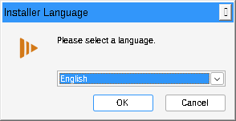
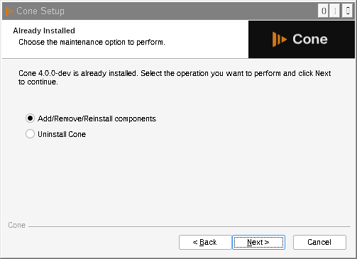
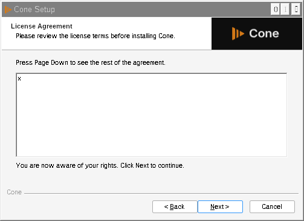
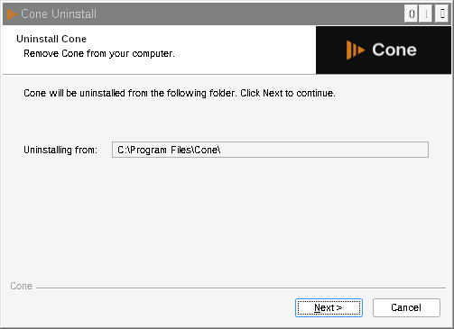
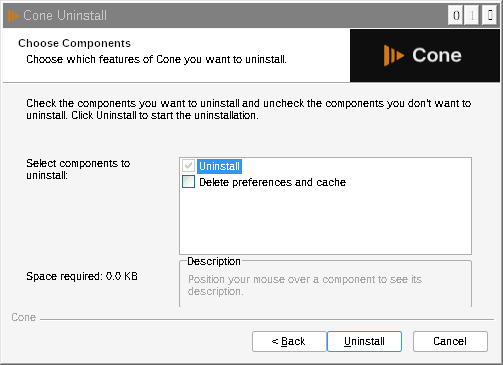
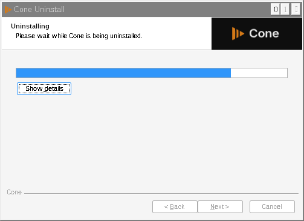

# Cone release: side by side with VLC (branch wip/cone-release)

Status: code done, **nothing verified on Windows**. Checked here only with makensis and Wine (see "Checks done here").
Everything below applies to the **public** brand profile only. The **vlc** profile builds exactly what it built before (how that was checked is under "Checks done here").

## 1. What changed

| # | Area | What Cone does now | Files | Commit |
|---|------|--------------------|-------|--------|
| 1 | Settings and data folder | `%APPDATA%\Cone` for vlcrc, media library, art cache, Lua and skins user data, the redesign's own files and crash dumps. Qt interface settings `%APPDATA%\Cone\vlc-qt-interface.ini` (Qt organization "Cone"; VLC keeps `%APPDATA%\vlc\vlc-qt-interface.ini`). Interface language in `HKCU\Software\Cone` (Lang). | `src/win32/dirs.c` (core), `bin/winvlc.c`, `modules/gui/qt/util/brand.hpp`, `qt.cpp`, `dialogs/sout/profile_selector.cpp`, `dialogs/redesign/settings/settings_catalog.cpp`, `dialogs/preferences/simple_preferences.cpp` | 254361a596 |
| 2 | Updates | No update checker and no update notice. `build.sh -B public` no longer passes `--enable-update-check`; configure and meson refuse the update check with the public brand. | `extras/package/win32/build.sh`, `configure.ac`, `meson.build` | fa02c8ccb8 |
| 3a | NSIS installer | Own ProgIDs `Cone.<ext>`, verbs `PlayWithCone` / `AddToPlaylistCone` (also on Directory, AudioCD, DVD), autoplay handlers `ConePlay*OnArrival`, ProgIDs `Cone.DVDMovie` etc., default programs entry `Software\Clients\Media\Cone` + RegisteredApplications "Cone", backup value `Cone.backup`, install key `HKLM\Software\Cone`, uninstall key `...\Uninstall\Cone`, App Paths `Cone.exe`, install folder `Program Files\Cone`, file name `cone-<version>-win64.exe`. The uninstaller removes only Cone's keys and `%APPDATA%\Cone`, and no longer touches VLC's old Mozilla plugin files and key. | `extras/package/win32/NSIS/vlc.win32.nsi.in`, `helpers/extensions.nsh`, `helpers/utils.nsh`, `spad.nsi.in`, `NSIS/meson.build`, `configure.ac` / `meson.build` (new `BRAND_PROGID`) | 40cd7e9d65 |
| 3b | MSI | Own product name, company, exe and icon, ProgIDs, registry keys, a new UpgradeCode and new component GUIDs (so it never upgrades, removes or shares components with VLC's MSI), looks for Cone's NSIS install (not VLC's) before installing, file name `cone-<version>-win64.msi`. | `extras/package/win32/msi/config.wxi.in`, `product.wxs`, `extensions.wxs`, `msi/meson.build`, `msi.mak` | 70e74426a4 |
| 3c | Installer look and wording | Cone images and texts, see section 2. The Cone uninstaller also removes the Blu-ray autoplay handler (VLC's uninstaller forgets it). | `extras/package/win32/brand/public/*.bmp`, `installer-art.js`, `NSIS/brand-languages.sh`, `vlc.win32.nsi.in`, `package.mak`, `NSIS/meson.build`, MSI files | 03580142e9 |
| 4 | Preferences file associations | The old preferences' association list and its Default Programs button used VLC's ProgIDs and install key (would have pointed file types at an installed VLC). Now Cone's. | `util/brand.hpp`, `dialogs/preferences/simple_preferences.cpp` | 146d6f00c7 |
| 5 | CI | A public build also builds `cone-<version>-win64.exe` and uploads it as the artifact **cone-installer-win64** (test only; this step cannot fail the build). | `.github/workflows/build-windows.yml` | 2ca74d52d6 |
| 6 | Audio session (Decision 57) | Own audio session GUID (own volume mixer entry and own saved session volume when "volume-save" is on) and the session name "Cone" (the user-agent name; the HTTP user agent is unchanged). | `modules/audio_output/mmdevice.c`, `winstore.c`, `bin/winvlc.c` | f2580bbf40 |
| 7 | Single instance (Decision 57) | Own mutex and IPC window name "Cone ipc <version>", so "Allow only one instance" never hands files to a running VLC. | `src/win32/specific.c` (core), `modules/control/win_msg.c` | b1d5a41ca4 |
| 8 | File associations next to VLC (Decision 56) | NSIS: on a first install, if VLC is installed (its install key, uninstall key or App Paths entry, 64-bit or 32-bit; only read) every file association starts unticked; without VLC they start ticked. A reinstall or upgrade keeps the user's saved choice. MSI (no backup of the previous handler): next to VLC the association features are left out entirely (level 0), without VLC they are ticked. | `NSIS/vlc.win32.nsi.in`, `msi/product.wxs` | 82f3ba9ec1 |
| 9 | Own version (Decision 58) and public name | One brand value: configure `--with-brand-version` / meson `-Dbrand-version` (default 0.1.0; `build.sh` reads `BRAND_VERSION`, the build-windows workflow sets it from a `vX.Y.Z` tag). About: "Cone 0.1.0" with "based on VLC <version>" under it, "Built by StickyGonzales". Installer: "Cone 0.1.0" in its title and pages, "based on VLC <version>" under every page, file `cone-0.1.0-win64.exe`, upgrade check on Cone's version. Windows Apps list: "Cone", version 0.1.0, publisher StickyGonzales. Exe ProductVersion and MSI version are Cone's (exe FileVersion stays VLC's). Publisher / company everywhere: StickyGonzales. | `configure.ac`, `meson.build`, `meson_options.txt`, `bin/vlc_win32_rc.rc.in`, `NSIS/vlc.win32.nsi.in`, `msi/config.wxi.in`, `util/brand.hpp`, `dialogs/help/help.cpp`, `build.sh`, workflow, README, CREDITS | d18d857d20 |
| 10 | Dialog texts | VLC's built-in dialogs, questions and errors say "Cone" (list under "Dialog texts" below). | core: `modules/demux/avi/avi.c`, `modules/demux/mp4/mp4.c`, `src/input/decoder.c`, `src/input/input.c`, `modules/access/dshow/dshow.cpp`, `dvdnav.c`, `ftp.c`, `vdr.c`, `modules/codec/avcodec/encoder.c`, `modules/codec/fluidsynth.c`, `modules/misc/audioscrobbler.c`, `bin/winvlc.c`; Qt: `dialogs/preferences/preferences.cpp`, `simple_preferences.cpp`, `dialogs/firstrun/firstrunwizard.cpp`, `dialogs/sout/profile_selector.cpp`, `dialogs/open/open.cpp`, `open_panels.cpp`, `dialogs/extended/extended_panels.cpp`, `network/addonsmodel.cpp` | see BUILD_NOTES |

Core changes (all inside `#ifdef VLC_BRAND_PUBLIC`, the vlc profile compiles the same tokens as before): `src/win32/dirs.c` (the folder name), `src/win32/specific.c` (single-instance name), `modules/audio_output/mmdevice.c` and `winstore.c` (audio session GUID), `modules/control/win_msg.c` (IPC window name), and the dialog texts of row 10 (`modules/demux/avi/avi.c`, `modules/demux/mp4/mp4.c`, `src/input/decoder.c`, `src/input/input.c`, `modules/access/dshow/dshow.cpp`, `modules/access/dvdnav.c`, `modules/access/ftp.c`, `modules/access/vdr.c`, `modules/codec/avcodec/encoder.c`, `modules/codec/fluidsynth.c`, `modules/misc/audioscrobbler.c`, `bin/winvlc.c`). Per the build rounds rule they go in their own build.

### Dialog texts

Public profile only. Each text is chosen by `#ifdef VLC_BRAND_PUBLIC`: in the core a `BRAND_TEXT_*` / `START_ERROR_*` macro defined at the top of the file (vlc_dialog_* are macros, so no directive can sit inside their arguments), in Qt an `#ifdef` around the `qtr("...")` call itself, and for a text that lives in a `.ui` file a `setText` / `setToolTip` after `setupUi` in the public profile only. The vlc profile compiles exactly VLC's tokens: checked by expanding the vlc branch's macros and comparing the token stream of every touched file with origin/wip/cone-release (identical; in the vlc profile the Qt files differ only by `#include "util/brand.hpp"` in `addonsmodel.cpp` and `firstrunwizard.cpp`, for config.h's VLC_BRAND_PUBLIC).

Translations: the vlc profile keeps VLC's msgids, so its translations are unchanged. The Cone wording is a new msgid (like the brand layer's earlier Cone texts: welcome, tray, About), so until Cone has translations of its own these sentences show in English in every language; the rest of each dialog (title, buttons) stays translated. Both the VLC and the Cone wording are literal arguments of `_()` / `qtr()` (core macros: `_()` inside the `#define`, as VLC's own `N_()` option texts), so a .pot regeneration still extracts VLC's msgids and adds the Cone ones. (The brand layer's earlier `qtr(BRAND_NAME)`-style texts in `util/brand.hpp` are not extracted; see BUILD_NOTES "Brand layer".)

| Where it shows | VLC text | Cone text |
|---|---|---|
| AVI and MP4 "Broken or missing Index" question | "VLC won't repair your file but can temporary fix this problem ..." | "Cone won't repair your file ..." |
| Codec not supported / Unidentified codec | "VLC could not decode the format ..." / "VLC could not identify the audio or video codec" | "Cone could not ..." |
| Streaming / Transcoding failed (decoder, packetizer, encoder) | "VLC could not open the %s module." / "... the decoder module." / "... the %4.4s %s encoder." | "Cone could not open ..." |
| Your media can't be opened | "VLC is unable to open the MRL '%s'. Check the log for details." | "Cone is unable to open ..." |
| Capture failed (DirectShow) | "VLC cannot open ANY capture device. ..." | "Cone cannot open ..." |
| DVD playback failure | "VLC cannot set the DVD's title. ..." | "Cone cannot set ..." |
| FTP network errors | "VLC could not connect with the given server." / "VLC's connection to the given server was rejected." | "Cone could not connect ..." / "Cone's connection ..." |
| VDR file errors | "VLC could not read the file (%s)." / "VLC could not open the file "%s" (%s)." | "Cone could not ..." |
| MIDI sound font missing | "... from the VLC preferences ..." | "... from the Cone preferences ..." |
| last.fm errors | "... relaunch VLC." / "... restart VLC." | "... relaunch Cone." / "... restart Cone." |
| Start failure message box (winvlc) | "VLC media player could not start. ...", title "VLC media player" | "Cone could not start. ...", title "Cone" |
| Old preferences: Reset / Restart Required | "Are you sure you want to reset your VLC media player preferences?" / "VLC needs to be restarted ..." | "... your Cone preferences?" / "Cone needs to be restarted ..." |
| Old preferences: Interface | "This is VLC's skinnable interface. ..." and the tooltips "VLC will use custom skin." / "VLC will use a modern / classic layout ..." | "This is Cone's skinnable interface. ..." / "Cone will use ..." |
| First-run wizard (only without the main window, e.g. skins2; the main window shows the onboarding) | privacy text "VLC media player ... VLC ... the VLC developers", "VLC will automatically ..." / "VLC will use a modern / classic layout ..." | "Cone ..." |
| Convert profile editor | label "... VLC will autodetect the other ..." and "This muxer is not provided directly by VLC ..." | "... Cone will autodetect ..." / "... directly by Cone ..." |
| Open Media | tooltip "Complete MRL for VLC internal", Jack "Use VLC pace" | "... for Cone internal", "Use Cone pace" |
| Add-ons list | "This addon has been installed manually. VLC can't manage it by itself." | "... Cone can't manage it ..." |
| v4l2 controls (Linux only) | "... opened with VLC and is playing." | "... opened with Cone ..." |

Kept on purpose: texts that name VLC's own catalog, file format or website rather than the app (Settings > Extensions "VLC's add-on catalog", "VLC add-on packages (*.vlp)", the "VLC skins website" link); log-only messages (`msg_Err` / `msg_Warn`, e.g. last.fm "This version of VLC has been banned"); the update dialog and update pane (`src/misc/update.c`, `help.cpp`, `UpdatePane.qml`: the public profile has no update checker); macOS-only dialogs (`avcapture.m`, `avaudiocapture.m`, `disc_helper.h`, `auhal.c`) and `mtp.c` (no libmtp in the Windows build); option descriptions in the preferences ("Start VLC with only a systray icon" and the core / module help texts): they are not dialogs and are a much larger, separate change.

"Local app data equivalent": VLC itself keeps nothing in `%LOCALAPPDATA%`. The only thing there is Qt's own cache, which Qt names after the exe: `%LOCALAPPDATA%\Cone` for Cone.exe, `%LOCALAPPDATA%\vlc` for vlc.exe. So it is already separate and needed no change.

## 2. Installer look

Bitmaps (exact size, 24-bit BMP, made by `extras/package/win32/brand/public/installer-art.js`): background Dark/BG/B1 #0E0E0E, the Cone logo in #D37918, Inter SemiBold "Cone" in Dark/FG/1 #EAEAEA, "Media player" in Dark/FG/A1 #969696, a 3 px accent line at the bottom of the side image. No VLC cone anywhere.

| Welcome / finish side image (164 x 314) | Page header image (150 x 57) |
|---|---|
|  |  |

| MSI banner (493 x 58; WiX draws the black title over the white left part) |
|---|
|  |

| MSI welcome / exit dialog image (493 x 312; WiX draws the text right of the dark panel) |
|---|
|  |

Wording: every installer and uninstaller text names Cone. The window titles are "Cone Setup" / "Cone Uninstall", the branding line is "Cone", the finish link is "Visit the Cone Website" (project page), and the shortcuts are "Cone", "Cone skinned", "Cone Website", "Documentation" (project README) and "Cone - reset preferences and cache files". The 35 translations are rewritten at packaging time by `brand-languages.sh` (VLC / VideoLAN become Cone; string IDs untouched).

Page order and behavior are unchanged: language, welcome, (already installed), license, components, folder, install, finish; uninstaller: confirm, components, uninstall, finish.

### The real Cone installer pages

Screenshots of the real NSIS installer built from this branch, run under **Wine** in this cloud session with a stub payload (dummy files, so the license text is an "x" and the sizes are tiny). Wine draws its own title bars, fonts and controls, so Windows 10 will look a little different (Segoe UI, Windows title bar); the images, layout and texts are the real ones.

| | |
|---|---|
| Language  | Welcome  |
| Already installed (second run)  | License  |
| Components  | Install folder  |
| Installing  | Finish  |

Uninstaller:

| | |
|---|---|
| Confirm  | Components  |
| Uninstalling  | Finish  |

The MSI pages could not be rendered here (no WiX toolset), only its two bitmaps above.

## 3. How to test (on the PC)

**Get the builds**
1. GitHub, Actions tab, "build-windows", "Run workflow", branch `wip/cone-release`, brand `public`, Run.
2. When it is green, open the run and download **cone-installer-win64** (the installer) and **vlc-redesign-win64-public** (the zip).
3. If the cone-installer-win64 artifact is missing, the installer step failed (it is allowed to fail): open its log. Testing the settings part (steps 7 to 9) still works with the zip.

**Before**
4. Have the normal VLC installed (from videolan.org). Open it once, change one visible setting (for example Tools, Preferences, Interface language, or a hotkey), close it.
5. Note what opens `.mp4` and `.mkv` (right click a file, Open with) and that "VLC media player" is listed in Settings, Apps, Default apps.

**Install Cone next to it**
6. Run `cone-<version>-win64.exe`. Check every page shows Cone (images, titles, texts) and no VLC cone. Keep the default components.
7. Check: `C:\Program Files\Cone` exists and `C:\Program Files\VideoLAN\VLC` is untouched; Start menu has a "StickyGonzales" folder with Cone's shortcuts and VLC's "VideoLAN" folder is still there; Settings, Apps lists both "VLC media player" and "Cone" (version 0.1.0, publisher StickyGonzales); Default apps lists both. Cone's Help, About shows "Cone 0.1.0" with "based on VLC 4.0.0-dev" under it.
8. Start Cone, change a setting, close it. Start VLC: VLC still has its own setting from step 4 and not Cone's. Start Cone again: it still has its own.
9. Check the folders: `%APPDATA%\vlc` (VLC's) and `%APPDATA%\Cone` (Cone's) both exist; the media library and art cache of each stay in its own folder. In `regedit`: `HKCU\Software\VideoLAN\VLC` (VLC's language) and `HKCU\Software\Cone` (Cone's) are separate.
10. On the components page (step 6) the file associations were unticked, because VLC is installed (Decision 56): `.mp4` still opens with VLC, and right clicking an `.mp4` shows only VLC's entries ("Play with Cone" sits on Cone's own file types, so it appears on a file only when Cone owns its extension). Right click a folder: "Play with Cone" and "Add to Cone's Playlist" are there next to VLC's. Windows 10 and 11 keep your own default app choice anyway. (Optional: reinstall Cone with the associations ticked, then uninstall it: `.mp4` opens with VLC again.)
10b. Volume mixer (Decision 57): play something in Cone and in VLC at the same time; Windows' volume mixer shows two entries, and changing Cone's volume leaves VLC's alone. Turn on Tools, Preferences, "Allow only one instance" in both; opening a file with Cone never adds it to the running VLC.
11. Check for updates: Cone has no update menu entry and never shows an update notice.
11b. Dialog texts (row 10): open a broken AVI (an .avi whose index was cut off, e.g. a truncated download): the "Broken or missing Index" question says "Cone won't repair your file". Open a file with an unknown codec, or a wrong path in Open Network Stream: the error says "Cone could not ..." / "Cone is unable to open the MRL". In the old Tools, Preferences dialog, Reset Preferences asks about "your Cone preferences". The vlc build shows VLC's texts at the same steps, translated as before (switch the interface language to check one).

**Uninstall Cone**
12. Settings, Apps, Cone, Uninstall (optionally tick "Delete preferences and cache").
13. Check: VLC still starts with its settings, `%APPDATA%\vlc` is untouched, `C:\Program Files\VideoLAN\VLC` is untouched, `.mp4` opens with VLC again (if it did before), VLC's context menu entries and its Default apps entry are still there, and nothing named Cone is left in `C:\Program Files`, the Start menu, Settings, Apps, or `HKLM\Software\Cone`.

**Your portable test folder** (`<TEST_MEDIA_DIR>\builds\current-public`): a public build now keeps the Qt interface settings in `portable\Cone\vlc-qt-interface.ini` instead of `portable\vlc\vlc-qt-interface.ini` (vlcrc and the rest stay in `portable`). Done on 2026-10-16 for `builds\current-public` (copied, the old file kept). For another public test folder, copy that one file over once, with the test VLC closed:

```powershell
$p = "<TEST_MEDIA_DIR>\builds\current-public\portable"; New-Item -ItemType Directory -Force "$p\Cone" | Out-Null; Copy-Item "$p\vlc\vlc-qt-interface.ini" "$p\Cone\vlc-qt-interface.ini"
```

## 4. Checks done here (not verification)

- `buildlists.py` and `privacycheck.py`: 0 problems before every push.
- makensis 3.09: both profiles' installers and `spad.nsi` compile (the same 67 missing-translation warnings as before).
- vlc profile unchanged: its preprocessed NSIS script (`makensis -PPO`) is identical to the one from origin/redesign (only NSIS's line-number labels differ). With the vlc values, `product.wxs` and `extensions.wxs` expand to exactly the old files. The configure / meson flags of the vlc profile are the same strings as before.
- Wine (stub payload, vlc-profile installer as "the installed VLC"):
  - VLC installed, then Cone installed, then Cone uninstalled: HKLM\Software and HKCR are identical to the VLC-only state. `.mp4` was `VLC.mp4`, became `Cone.mp4` with `Cone.backup = VLC.mp4`, and went back to `VLC.mp4`.
  - Cone installed, then VLC uninstalled: no Cone key or value was removed.
- C++: the changed lines were syntax-checked in isolation only; the Qt module and the core were not compiled here (the CI build does that).

## 5. Left as is, or not done

**Engine code**
- Shared audio session and single instance: fixed by Decision 57 (rows 6 and 7 above).
- Crash reporter: `bin/breakpad.cpp` reports as product "VLC" (only built with breakpad; CI does not).
- `libvlc_set_app_id("org.VideoLAN.VLC")` in `bin/winvlc.c` was kept on purpose by the brand layer.

**Packaging, small, noted**
- The zip and its folder keep VLC's names (`vlc-<version>-win64.zip`, folder `vlc-<version>`), because the workflow unzips `win64/vlc-*-win64.zip`. Not an install clash.
- The MSI installs into `Program Files\StickyGonzales\Cone` (WiX layout: company\product); the NSIS installer into `Program Files\Cone`.
- The Start menu folder is the publisher, "StickyGonzales" (same rule as VLC's "VideoLAN").
- "Release Notes" opens VLC's `NEWS.txt` (VLC's own changelog text). "New_Skins.url" still opens VLC's skins page (VLC skins work in Cone's skinned interface).
- `spad-setup.exe` (the Default Programs show/hide helper) is built but, as in VLC's installer, not installed; its registry entry is Cone's own.
- HiDPI: the bitmaps are 1x (164 x 314, 150 x 57), like VLC's; at 125 to 150 percent Windows scales them up slightly soft.
- Uninstall order: if VLC is uninstalled first, Cone's backup still names `VLC.<ext>`; uninstalling Cone later restores that dangling name (harmless, Windows ignores it). Same behavior as VLC's own installer.
- The MSI is not built by CI, and its pages were not rendered (no WiX here).
- The meson packaging path (`-Dbrand=public`) was updated but not run.

**Decided**
- Decision 56: the file associations start unticked when VLC is installed, ticked when it is not (row 8). VLC from the Microsoft Store is not detected (it has no registry install key), so next to it they start ticked.
- Decision 57: own volume mixer entry, own saved volume, own single-instance identity (rows 6 and 7).
