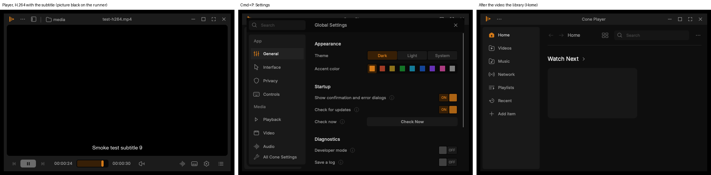
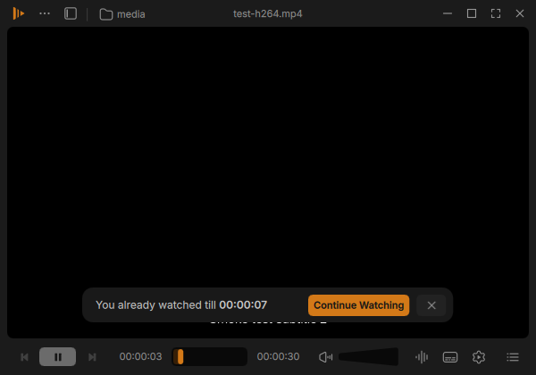

# Cone for macOS (branch wip/macos-build)

Branch `wip/macos-build`, kept up to date with `origin/wip/next-test` (merged 2026-11-08, no conflicts). Draft pull request into `wip/next-test`. CI only: no change to Cone's code. Nothing is released by this branch. Every release tag prepares a macOS **draft** that StickyGonzales publishes by hand, or never.

## What it is
- **Cone Player.app** (the public profile, Cone's redesign) in a `.dmg`, for **Apple Silicon** Macs (M1 and later) and **Intel** Macs, macOS 12 or later.
- Two .dmg files, `Cone-<version>-macos-arm64.dmg` and `Cone-<version>-macos-x86_64.dmg`.
  - Both are built on GitHub's macOS runners by `build-macos.yml` on every run: `macos-15` for Apple Silicon, `macos-15-intel` for Intel.
  - A manual run can leave Intel out.
  - Intel's first build had no compiler cache and took about 2 h 40 min; later builds reuse the cache.
- **Signed ad hoc** (no Apple developer account): it runs, but macOS asks once before opening it (see "Opening an unsigned app").

## How it is built
| File | What it does |
|---|---|
| `.github/workflows/build-macos.yml` | the build: contribs, Qt, ccache, build, package, artifact, test-builds asset; then the smoke checks |
| `.github/scripts/macos-build.sh` | VLC's own macOS steps (`extras/package/macosx/build.sh`): extra tools, contribs, configure, make, make install |
| `.github/scripts/macos-package.sh` | `Cone Player.app` and the `.dmg` |
| `.github/workflows/smoke-macos.yml` | the smoke checks on a second, clean macOS runner |
| `.github/scripts/macos-smoke.py` | the checks |

**Contribs.** VideoLAN's prebuilt macOS contribs of exactly this source (`artifacts.videolan.org/vlc/macos-arm64/vlc-contrib-aarch64-apple-darwin19-<sha>.tar.zst`), found the same way the Windows build finds its own (`extras/ci/get-contrib-sha.sh`). They hold FFmpeg, the media library, libass, x264/x265, dav1d and the rest. Without a prebuilt set (a contrib change of our own), they are built from source and cached.

**Qt.** VideoLAN's macOS contribs build no Qt (VLC's own macOS app has a native interface), so Qt **6.8.3** (the version Cone bundles on Windows) comes from Qt's own macOS binaries (`aqtinstall`, with Qt Shader Tools for the interface's shaders), cached between runs.

**The interface.** VLC's macOS configure options (`extras/package/macosx/configure.sh`) with `--disable-macosx` (no native interface: Cone's design is its only interface, Decision 63), `--enable-qt`, `--disable-sparkle` (no VLC updater; Cone has its own update notice), `--disable-debug`, `--with-brand=public`. Upstream VLC already runs the Qt interface on macOS (on the main thread, as Cocoa requires: `modules/gui/qt/qt.cpp`) and embeds the video with the "platform" compositor. No core change was needed.

**The app** (VLC.app's layout from `extras/package/macosx/package.mak`, without the native interface):
- `Contents/MacOS/Cone Player` (VLC's macOS binary, `bin/darwinvlc.m`), `vlc-preparser`, `vlc-qt-check`;
- `Contents/Frameworks/`: `libvlc*.dylib`, `plugins/` (every plug-in, flat), the Qt frameworks;
- `Contents/PlugIns/`: Qt's own plugins (Cocoa platform, macOS style, image formats, SVG icons);
- `Contents/Resources/`: `qt.conf`, `qml/` (the Qt Quick modules the interface imports), `share/` (Lua scripts, HRTFs, translations), `cone.icns` (Cone's logo);
- `macdeployqt` copies Qt into the app and rewrites the load paths; the package step fails if anything still loads Qt from the build machine;
- the plug-in cache is generated (`vlc-cache-gen`);
- every binary is signed ad hoc, then the frameworks, then the app; `codesign --verify --deep --strict` must pass.

**Its own settings.** Bundle identifier `io.github.stickygonzales.coneplayer`: VLC's core keeps its files in `~/Library/Preferences/io.github.stickygonzales.coneplayer/` and `~/Library/Application Support/io.github.stickygonzales.coneplayer/` (`src/darwin/dirs.m` names them after the bundle), the interface in `~/Library/Preferences/com.cone.vlc-qt-interface.plist`. An installed VLC is never touched.

**The .dmg:** `Cone-<version>-macos-arm64.dmg`, with `Cone Player.app`, a link to Applications and `COPYING.txt` (the GPL). Plain, without VLC's background picture (it shows VLC's cone).

**Where to download a test build:** the run's artifact `cone-macos-arm64` (one day), or the asset `wip-macos-build--macos-arm64.dmg` on the draft pre-release `test-builds` (redesign/TEST_BUILDS.md). Never a release.

## Releases: a Mac .dmg with every release
`release-macos.yml` runs on every release tag:
- `vX.Y.Z` (the Windows release);
- `linux-vX.Y.Z[-label]` (the Linux release);
- `macos-vX.Y.Z[-label]` (macOS alone).

What it does:
- **Guard.** Only commits on `redesign` (verified code), as the Windows and Linux releases.
- **Build.** It builds both .dmg files with `build-macos.yml`, smoke checks included. A release build never touches the test-builds draft.
- **Draft.** It prepares a **draft pre-release** `macos-v<version>`, "Cone <version> for macOS (experimental preview)", with both .dmg files and `SHA256SUMS.txt`. The notes say which file is for which Mac and how to open an app without a Developer ID.
- **Shared draft.** The Windows and the Linux tag of one version refresh the same draft. A published release is never changed.
- **Never published.** Nothing is public until someone presses Publish on the Releases page. The draft's tag is created only then.

## Smoke checks (after every macOS build)
On a second, clean runner of each architecture (`macos-15`, `macos-15-intel`), with the Windows and Linux checks' test media (`smoke-media.sh`: 30 s H.264 and HEVC MP4, an SRT file). Each failed check runs once more. Results artifacts: `cone-macos-smoke-results-arm64` and `-x86_64` (summary, log, each Cone start's own log, screenshots, VLC's snapshots).

What the runner cannot always confirm is a **warning**, not a failure, so the run stays green on runner quirks:
- **"Settings opens" and "Escape closes Settings":** synthetic keys reach Qt's window unreliably there. Both are on the tester list.
- **A slow HEVC quit on the Intel runner:** 3.2 to 3.5 s, while Cone still quits by itself (as the HEVC quit on Windows and Linux).

A Cone that exits by itself is reported as such, with its own log. Its retry starts a fresh session.

**Cone quit at its start (runs 10 and 11) and the quit watchdog on every Cmd+Q (run 12): the smoke script, not Cone.** The checks talk to Cone through VLC's remote control socket (`--extraintf=cli --rc-unix=...`). They also passed `--rc-fake-tty`, which makes the cli read commands from stdin as well. VLC's cli quits VLC when stdin ends: the runner's stdin ends at once, so every start's log has a quit (`main debug: exiting`); when it came before the interface was up it was lost (`no exit handler`), when it came just after, Cone quit cleanly 3 to 4 s after its start (run 11, HEVC on Apple Silicon). Run 12 gave Cone a stdin that stays open: the starts were fine, but at the quit the cli waits for its stdin reader, which a read blocked on an open pipe on macOS never lets go, and the quit watchdog ended Cone after 5 to 8 s (both architectures, H.264 too). Now: no `--rc-fake-tty` and `/dev/null` as stdin, so there is no stdin reader at all; the socket alone answers (checked with the Linux build: `get_time`, `strack`, quit in 0.4 s), and the script reads each whole reply (the socket also gets VLC's status lines). The video output tries were not hit (none of their logs has the quit after the interface was up), so the black-picture findings stand. The Linux checks still use `--rc-fake-tty` (no failure there so far).
- **dmg:** it opens, holds the app and the Applications link; the app copies out (`ditto`, as a Finder drag).
- **Signature:** `codesign --verify --deep --strict` passes; the name and the bundle identifier are Cone's.
- **Gatekeeper** (information only): `spctl` rejects it, as every app without a Developer ID; the reason testers open it once with right-click > Open.
- **Two sessions (H.264, HEVC):**
  - the main window appears (CoreGraphics' window list);
  - the playback time advances (VLC's cli interface on a Unix socket);
  - H.264 only: the subtitle file loads (`strack`); **Cmd+P** opens Settings and **Escape** closes it (real key events; the dialog is looked for in the app's accessibility tree when the runner allows this process to read it, otherwise the middle of the window must change and change back);
  - **Cmd+Q** quits in under 3 s (HEVC: a quit the watchdog ends is a warning, as on Windows and Linux);
  - no "cannot load plug-in" line in Cone's log.
- **Settings folders:** Cone's own, VLC's untouched.

What a runner cannot check: picture quality, sound (VLC's dummy audio output), real mouse use of the controls (there is no accessibility access to drive the interface the way the Windows and Linux checks do), Retina scaling on a real display, and Gatekeeper's first-open prompt.

## Results
Smoke checks on GitHub's `macos-15` runner (Apple Silicon, macOS 15.8, a virtual machine), the last runs:

| Check | Result |
|---|---|
| dmg opens, holds the app, the Applications link and COPYING.txt; the app copies out | pass |
| ad-hoc signature verifies (`codesign --verify --deep --strict`); bundle `io.github.stickygonzales.coneplayer`, "Cone Player" | pass |
| Gatekeeper | rejected, as expected for an app without a Developer ID (information) |
| main window | pass, 1.1 to 2.3 s |
| H.264 and HEVC: the playback time advances | pass, both |
| subtitle file loads | pass |
| Cmd+P opens Settings | the dialog opened in runs 6 and 7 (screenshots); see "Runs" for the check itself |
| Cmd+Q | pass, under 3 s |
| every plug-in loads (388) | pass; the plug-in cache is current (no "stale plugins cache" line since run 7) |
| own settings folders, VLC's untouched | pass |
| picture (information) | black in the middle of the video, with hardware **and** software decoding; the subtitles and the interface draw |



## What works, what doesn't
**Works (on the runner):**
- Cone's redesign as the interface: top bar, control bar with the seek bar, the subtitle, Settings (Global Settings: theme, accent, startup, diagnostics), the library's Home page.
- Playback of H.264 and HEVC (time advances), external subtitles, quitting, every plug-in, Cone's own settings folders next to an installed VLC.
- The .dmg, the app bundle, its ad-hoc signature and its Cone icon.

**Not known yet / to check on a real Mac:**
1. **The video picture.** On the runner it stays black (VLC's macOS video output `samplebufferdisplay`, embedded by the Qt interface's "platform" compositor), also with software decoding, while the subtitles drawn into the same video show. The runner is a virtual machine with a paravirtual GPU (Qt also could not create an OpenGL context there), so this is most likely the runner. **The first thing a tester checks.**
2. **Escape in Settings** and keyboard shortcuts in general: the runner delivers synthetic keys unreliably to Qt's window (the first Cmd+P after the local network prompt was lost; Escape did not close Settings in one run).
3. **The local network prompt:** macOS asks once whether Cone may find devices on the local network (VLC's UPnP / Bonjour discovery for the Network view); Info.plist now gives the reason. Declining it only empties the Network view.
4. **The update notice:** Settings shows "Check for updates" On. Cone's checker looks at the Windows / Linux releases; there is no macOS release, so a Mac build should not point to one. Left as is in this experimental build (a code change, not CI); to be decided before any macOS release.
5. **Not built:** Sparkle (VLC's macOS updater), VLC's native macOS interface (Cone's design is the only interface), the fancy .dmg background (VLC's shows VLC's cone). Intel is built on every run since 2026-11-08.

## The see-through or half-drawn picture: Cone, also on a real Mac (issue #69)
The tester's Mac (issue #69, macOS on Apple Silicon) showed the **video area see-through** (the text editor behind the window showed in Cone's video area) with **the picture only partly drawn** (a band at the top, the picture pushed down), and after the first file often **no picture at all**; sound and subtitles worked. So the section below, "the runner, not Cone", was wrong: it is in Cone's macOS video path, and the runner's black picture is most likely the same fault on a dark desktop.

**Why.**
- **How the video is embedded:** Cone uses VLC's "platform" compositor on macOS (`maininterface/compositor_platform.cpp`). It is a top-level window with a video window inside it and Cone's interface (a transparent Qt Quick window) above both. VLC's macOS video output (`samplebufferdisplay`, AVSampleBufferDisplayLayer) got Qt's own view of the video window (`QNSView`).
- **Partly drawn:** the output places its picture for an ordinary, unflipped macOS view: `y = height - y - h` (`VLCSampleBufferDisplay.m`, `frameForPlace`). Qt's view is flipped (origin at the top), so the picture could land at the wrong height.
- **See-through:** the output paints nothing outside the picture, and Qt's view has no background. In the letterbox bands, and before the first frame, only the transparent interface window lay above, so the desktop behind Cone showed through.

**The fix** (`compositor_platform.cpp`, macOS only).
- The output now gets a plain NSView of Cone's own inside the video window: unflipped, opaque black (like VLC.app's video area), and always the video window's size.
- The bands are black and the picture sits where VLC places it.
- It is made through the Objective-C runtime (the file is C++), with no message that returns a struct, so Intel and Apple Silicon behave the same.

**On the runner** (build-macos run 17) the video area now draws: screen colour 135 to 222 in the middle of the video, 0 in every run before. A real Mac confirms it (tester list, step 1).

## The black picture on the runner (run 10, both architectures; see the section above)
On both runners the video area stays black while Cone's interface and the subtitles draw:



Each of VLC's macOS video outputs was tried on the same H.264 file, with a screenshot of the window and VLC's own snapshot of the decoded picture. Colour is the mean spread between red, green and blue in the middle (the test pattern: far above 40; black: 0).

| Setup | Video output | Screen | Decoded picture (VLC snapshot) |
|---|---|---|---|
| Default (hardware decoding) | `samplebufferdisplay` (AVSampleBufferDisplayLayer, Metal) | black (0) | **colourful** (238 Intel; arm64 not saved) |
| Software decoding | `samplebufferdisplay` | black (0) | **colourful** (239 arm64, 237 Intel) |
| `--vout=samplebufferdisplay --force-darwin-legacy-display` | none: "no vout display modules matched" | black | none |
| `--vout=caopengllayer` | none: "Failure to create CGL context!" | black | none |
| `--vout=macosx` | none: "Initialization of open gl view failed" | black | none |
| `--vout=gl` | none: no OpenGL display module | black | none |
| `-I dummy` (no Qt, VLC's own window) | none: macOS's video window needs an application object, which the dummy interface does not create (`wdummy`: nothing to see) | black | none |

**What it shows.**
- **Decoding is fine.** VLC's snapshots of the decoded frames are the full test pattern, with hardware and with software decoding.
- **Only the display is black.** The one video output that opens on the runner is `samplebufferdisplay`, Apple's AVSampleBufferDisplayLayer on Metal.
- **No OpenGL on the runner.** The runners are virtual machines with Apple's paravirtual GPU ("Metal device: Apple Paravirtual device"). They have no OpenGL at all: Qt's OpenGL context fails, and so do the three OpenGL outputs.
- **A missing scaler.** Every start logs "IOServiceMatching failed for: AppleM2ScalerParavirtDriver". That is the hardware scaler service AVSampleBufferDisplayLayer uses to put video on screen, and it is missing in the virtual machine.
- **Conclusion at the time (corrected above).** It was put down to the runner's virtual GPU. Issue #69 showed the same family of fault on a real Mac, so it was Cone's video embedding.
- **The one oddity.** "blending YUVA to CVPN failed" (the subtitles blended into the picture buffer) shows on the runner too. If a real Mac shows the picture but not the subtitles, that is where to look.

## Opening files from Finder, and folders macOS protects (issue #69)
- **Finder did nothing.** Finder opens files with an "open documents" Apple event, not on the command line. Qt delivers it as `QEvent::FileOpen` to the application. VLC's own macOS interface handles it; Cone's Qt interface did not.
  - **Fix:** `qt.cpp` handles it (macOS only): the files go to the play queue and the first plays. This covers a double-click, Open With, a drop on the Dock icon, a start from Finder, and a Cone that already runs.
  - **Several files at once:** the files of one Finder action arrive one by one and are added together.
  - **When they play:** a start's files wait until the interface is open (its window and video surface made), like the command line's files; started earlier, the video output could stall at its start (build-macos run 29, Intel).
- **Open With did not list Cone.** The bundle declared no document types.
  - **Fix:** `Info.plist` now lists video, audio and playlist types (`CFBundleDocumentTypes`, rank Alternate). Cone shows under Open With without taking over the files.
- **Playlists with songs on the Desktop.** The tester's `.m3u` listed `.mp3` files under `~/Desktop`, and each failed with "Your media can't be opened".
  - **Cause:** macOS protects the Desktop, Documents and Downloads folders. An app needs the user's permission to read files there that the user did not open directly, and the songs in a playlist are such files.
  - **Fix:** `Info.plist` now has the purpose strings (`NSDesktopFolderUsageDescription`, Documents, Downloads, removable and network drives), so macOS asks with a reason.
  - **If access was refused once:** System Settings > Privacy & Security > Files and Folders > Cone Player: turn Desktop Folder on.
  - **Each new build asks again:** macOS remembers the permission per signature, and Cone's ad-hoc signature changes with every build.
- **A start from Finder still showed no file (follow-up, branch `wip/macos-finder-launch`).** With the filter installed right after the QApplication (run 18), a file opened while Cone runs played, but a Cone started by the open did not: the start's open event never reached the Qt interface.
  - **Fix:** Cone's own macOS startup code (`bin/darwinvlc.m`, before any interface or window exists) installs a handler for the "open documents" Apple event, and installs it again when AppKit finishes launching, where AppKit sets up its own handlers. Every such event while Cone runs comes there first. A start's documents come in the launch event itself, which AppKit does not send through the handlers (run 20): the handler reads it when launching finishes (`currentAppleEvent`). The handler keeps the files until launching has finished, then hands them to the application delegate (Qt's). Qt turns them into the `QFileOpenEvent` the interface's filter keeps until the play queue is ready; the first file plays.
  - **No core change:** VLC's play queue functions are not exported to the app, so the files take Qt's own path, the one that already worked for a running Cone.
  - **The real cause (run 31):** before its own window, the Qt interface runs `vlc-qt-check`, a small program that checks Qt starts. It sits in the bundle (`Contents/MacOS`), so its QApplication checks in with LaunchServices as Cone Player itself and takes the start's open request, then exits with it. Cone no longer runs it on macOS (`modules/gui/qt/qt.cpp`): a Mac app that LaunchServices starts always has the window server, and the bundle ships its own Qt. A minimal Cocoa app on the runner gets a start's file, also when it creates its NSApplication late.
  - **Log:** each step goes to stderr: `macOS: open-documents event with N file(s) (at launch / while running)`, `macOS: N opened file(s) passed to the interface`; the Qt interface then logs `macOS: open <file> from Finder`.
- **Smoke:** two checks open a file through LaunchServices (`open -a`, as Finder does): one while Cone runs (passes on both runners since run 17), one starting Cone with the file. The start check catches Cone's stderr (`open --stderr`) and prints every `macOS:` line from it and from Cone's log, so the result shows where the request went. Both stay warnings until they pass on the runners.

## The shortcuts page of the first start (issue #69)
- **What the tester saw:** "COMMAND" and "CTRL" written out made the key caps of "Learn the basic keyboard shortcuts" run past the right edge, and a "/" sat on a label.
- **Mac key symbols** (`onboarding_helper.cpp`, macOS only): the modifiers are shown as the Mac's own symbols, ⌃ ⌥ ⇧ ⌘, in Apple's order.
- **The queue shortcut:** "Show / Hide Queue" is ⌘L on a Mac. It is a Qt shortcut, and Qt's Ctrl is the Command key there; the page had shown "CTRL L".
- **Fitting the window** (`Onboarding.qml`): the key and label columns take the width of their widest row, and if both blocks are still wider than the page, they shrink to fit. This holds on any system, with any keys and any language.

## Opening an unsigned app (for testers)
Cone Player for macOS has no Apple Developer ID, so macOS says it "cannot be opened because Apple cannot check it for malicious software" the first time. Either way below works once; after that it opens normally.

**Right-click > Open (easiest):**
1. Open the `.dmg` and drag **Cone Player** onto **Applications**.
2. In Applications, **right-click** (or Control-click) **Cone Player** and choose **Open**.
3. In the warning, click **Open**.
   - macOS 15 (Sequoia) and later: if the warning has only **Done** / **Move to Trash**, click **Done**, then go to **System Settings > Privacy & Security**, scroll down to "Cone Player was blocked", click **Open Anyway**, and confirm with your password.

**Terminal (one command):** removes the download's quarantine flag from the app:
```
xattr -dr com.apple.quarantine "/Applications/Cone Player.app"
```

## Test list for a volunteer tester (about 15 minutes)
Any Mac with macOS 12 or later: the `-macos-arm64.dmg` for Apple Silicon (M1 and later), the `-macos-x86_64.dmg` for Intel. Note the Mac model and the macOS version; for each step, "works" or what happened (a screenshot helps).
1. **Install and open:** drag Cone Player to Applications, open it with right-click > Open (see above). The dark Cone window appears.
2. **The picture (most important):** drag an MP4 and an MKV onto the window. Do you see the video, not a black area? Sound?
3. **Controls:** pause, seek on the seek bar, volume, fullscreen (button and F, Escape back).
4. **Subtitles:** a video with an .srt of the same name: they show and can be switched.
5. **Settings:** Cmd+P opens Settings; Escape closes it; a changed theme is kept after quitting.
6. **Quit:** Cmd+Q quits within a few seconds.
7. **Anything odd:** a crash (copy the first 40 lines of macOS's report), a freeze, cut-off text, blurry text on a Retina display.

## Tester list for the issue #69 fixes (about 10 minutes)
A build that has the fixes of `wip/macos-fixes` and `wip/macos-finder-launch` (Actions > build-macos > the run > Artifacts: `cone-macos-arm64` for Apple Silicon, `cone-macos-x86_64` for Intel). Each step: what to do, and what you should see.
1. **The picture.**
   - **Do:** play a 16:9 video in a window that is taller than the video, then a second video right after.
   - **See:** the whole picture, with black bands above and below; nothing of the desktop or another window shows through, and the second video shows too.
   - **Then:** resize the window and go fullscreen and back; the picture follows.
2. **Finder, Cone closed.**
   - **Do:** quit Cone fully (⌘ Q; no Cone icon left running in the Dock), then double-click a video in Finder, or right-click > Open With > Cone Player.
   - **See:** Cone starts and plays that video within a few seconds. Cone may not be the default player, but it is listed under Open With.
   - **Also:** quit again, select three videos in Finder and Open With > Cone Player: all three are in the queue and the first plays. Quit again and drop a video on Cone's Dock icon (Keep in Dock first): it starts and plays.
   - **If nothing plays:** start Cone from Terminal with `open -a "Cone Player" --stderr ~/cone-open.txt <a video>` and send `~/cone-open.txt` (it shows whether the open request arrived).
3. **Finder, Cone open.**
   - **Do:** with a video playing, open another one from Finder (Open With > Cone Player, or drop it on Cone's Dock icon).
   - **See:** the new file plays in the same window. Select three files and Open With Cone: all three are in the queue and the first plays.
4. **The first-start shortcuts page.**
   - **Do:** start Cone once with `open -a "Cone Player" --args --qt-privacy-ask` and go to "Learn the basic keyboard shortcuts".
   - **See:** every key cap is inside the page, the modifiers show as ⌃ ⌥ ⇧ ⌘, and Show / Hide Queue reads ⌘ L.
5. **A playlist with songs on the Desktop.**
   - **Do:** open your `.m3u` again.
   - **See:** macOS asks whether Cone Player may access the Desktop folder; after Allow, the songs play.
   - **If it does not ask:** System Settings > Privacy & Security > Files and Folders > Cone Player > Desktop Folder on, then open it again. If it still fails, send the log (Tools > Messages, or the text the Errors tab shows).

## Runs
| Run | Head | What it showed / what changed |
|---|---|---|
| build-macos #1 | 0477d8adb2 | bootstrap failed: Homebrew's folder (with python3) on the build PATH made extras/tools take Homebrew's autotools and pkg-config → Homebrew kept off the PATH |
| #2 | acaf70691b | VLC compiled; the ncurses plug-in's link lost the system libraries: VideoLAN's prebuilt contribs name their build machine's SDK (MacOSX26.2.sdk) in their .pc / .la files → pointed at the runner's SDK |
| #3 | 21d7718077 | **the whole build passed** (Qt interface, 388 plug-ins); packaging: `bin/vlc-cache-gen` is libtool's wrapper script, macdeployqt copied QtSql's database drivers → the installed generator, no SQL drivers |
| #4 | 905d859d99 | signing failed: `plugins.dat` (data) unsigned under Contents/Frameworks → signed inside out, as `extras/package/macosx/codesign.sh` |
| #5 | 3b86520509 | **build, app, signature and .dmg green** (97 MB); first smoke run: window, H.264, HEVC, subtitles, Cmd+Q, plug-ins, own folders pass; Settings failed (the local network prompt held the keyboard); "stale plugins cache" (signing changed the plug-ins after the cache) |
| #6 | cd3ba554cb | cache made after signing; prompt dismissed; Settings opened (screenshot) but Qt's content is not in the runner's accessibility tree; cache still stale |
| #7 | 544027e979 | `cp -R` into the .dmg did not keep the files' times (VLC checks them to the second) → `ditto`; cache current; Settings opened in the picture, Escape did not close it |
| #8 | 22e9f4c8e4 | the 30 s test video had ended before the Settings check (Cone on its Home page) → the video repeats (`--input-repeat=50`, as on Linux) |
| #10 | 1d030deb4b | merged `wip/next-test`; **both architectures built** (Apple Silicon 43 min; Intel 2 h 40 min, its first build, no compiler cache). Smoke: Apple Silicon passes everything except one HEVC session, which exited by itself (code 0) after its window appeared, its log overwritten by the retry; Intel passes everything except the HEVC quit (3.22 s, then 3.46 s, limit 3 s). The video output tries (section "The black picture"). Then: each start its own log, the time check's retry in a fresh session, the HEVC quit time a warning, VLC's snapshots kept |
| #11 | 519b7260ff | both architectures **built** (Apple Silicon 12 min, Intel 34 min with the compiler cache). Smoke: **Intel green** (warnings: Settings/Escape); Apple Silicon passes everything except the HEVC playback check: Cone quit twice 3 to 4 s after its start, caused by the smoke script's stdin (section "Smoke checks"). Then: Cone gets an open stdin |
| #12 | cbb1bf04e3 | both built. Smoke: playback passes on both (no more quit at the start); Cmd+Q now ended by the quit watchdog on both (5 to 8 s): the open stdin held the cli's reader (section "Smoke checks"). Then: no `--rc-fake-tty`, stdin `/dev/null`, whole replies read |
| #18 | b42852d0ac | both architectures built and smoke-tested (Apple Silicon's smoke after one runner-less cancel). Picture draws on both (Apple Silicon 113 to 135, Intel 205). Finder: a file opened while Cone runs plays (pass, both); a start with a file still does not play (warning, both), although the filter now listens from the QApplication on: the launch's open event does not reach Qt at all. Next run: Qt's macOS application logging for that check |
| #17 | fdb49562c9 | wip/macos-fixes (issue #69). Intel built in attempt 1; Apple Silicon got no runner in runs 15-17 (cancelled after 15 min of waiting, three times) and built in attempt 2. **The picture now draws on the runners:** screen colour in the middle of the video 135 to 222 (Apple Silicon) and 188 to 222 (Intel), was 0 in every run before; VLC's own snapshot 237 to 239 as before. So the runner's black picture was the same embedding fault as the tester's, and the video view of Cone's own fixes it there. Finder: a file opened while Cone runs plays in it (pass, both); a start with a file did not play it (warning, both): the open event came before the filter, which was installed after the main interface. Then: the filter right after the QApplication, the files waiting for the play queue. Warnings as before: Escape in Settings; Intel's HEVC quit 3.33 s |
| #13 | 489d93c479 | **all green**: both architectures built (Apple Silicon 15 min, Intel 24 min with the compiler cache) and both smoke jobs pass (.dmg, signature, window, H.264 and HEVC playback, subtitles, Settings, Cmd+Q, every plug-in, own folders); one warning left, Escape in Settings (on the tester list). The video output tries as before: decoded frames full colour, screen black |
| #9 | a559a4a7ca | build, app, signature and .dmg **green** (the latest .dmg: artifact `cone-macos-arm64` of run 41346080677, and `wip-macos-build--macos-arm64.dmg` on the test-builds draft); the smoke job **never started**: it waited about 15 minutes for a free macOS runner and was cancelled without running a step |
| #20 | d23c5beea8 | Intel only (Apple Silicon runners scarce), green with smoke. Finder while Cone runs: pass, now through Cone's own handler (stderr: event while running, file passed to the interface; Qt: open from Finder). Finder start: still warns, and the trail shows why: the handler was installed at launch but no open-documents event ever reached it, nor Qt. A start's documents come in the launch event itself, which AppKit does not send through the handlers. Next (79a16899d5): read the launch event when launching finishes (`currentAppleEvent`); a file already waiting is not added twice |
| #23 | 0cc2fdb2a9 (code 79a16899d5) | Intel only, green with smoke. Finder while Cone runs: pass. Finder start: still warns; the trail reads "no launch event": at the end of launching AppKit holds no open-documents event either, so the smoke's start (`open -n -a ... --args ...`) delivers no open request at all. Next (e3e8190527): the smoke also starts Cone exactly as Finder does (`open -a` with the file only) and reports that trail; Cone logs its argument count and whether macOS calls the launch plain or one to open documents |
| #25 | e3e8190527 | Intel only, green with smoke. Finder while Cone runs: pass. A start exactly like a Finder double-click (`open -a` with the file only): Cone starts with no arguments and macOS calls it "a launch to open documents", yet no open-documents event reaches the handler, the launch event is empty and Qt's filter sees nothing (the smoke's `open -n ... --args` start: the same). Next (d4f92337fb): log the application delegate's open methods and every call to them, to see whether AppKit hands the files straight to Qt's delegate |
| #27 | d4f92337fb | Intel only, green. Qt's application delegate (QCocoaApplicationDelegate) has openFiles; nothing called it after launching began; still no event and no launch event |
| #29 | 5fda23819d | Intel only, green. One timeline (ms since main): the delegate is set at about 300 ms, Cone's Qt filter listens before AppKit's finishLaunching (about 770 ms), macOS calls it "a launch to open documents", and then, for 20 s: no open-documents event, no launch event, no openFiles call, no Qt file event. On the runner the start's open request is never delivered at all; nothing in Cone or Qt drops it. VLC's own macOS interface takes a start's files the same way (the delegate's openFiles). Next: a control, a minimal Cocoa app started with a file the same way, once creating NSApplication at once and once 0.5 s late like Cone |
| #31 | f132841ad5 | Intel only, green. The control: a minimal Cocoa app started with a file the same way gets it (`openFiles with 1 file(s)`), also when it creates NSApplication 0.5 s late. So the runner delivers a start's documents and the cause is in Cone's start: the Qt interface first runs `vlc-qt-check`, a program in `Contents/MacOS` that creates a QApplication; it checks in with LaunchServices as Cone Player itself, takes the start's open request and exits with it. Fix (next commit): no Qt check on macOS; the timeline diagnostics and the control removed |
| build-macos #29 (both) | 6bbdd9946a | Both architectures built and smoke-tested. **The start's open request now reaches Cone on both** (trail: open-documents event, 1 file waiting at launch; launch to open documents; passed to the interface; Qt: open from Finder), also for a start exactly like a Finder double-click. Apple Silicon: **the start check passes**, the file plays. Intel: the file opens, then the video output stalls at its start: playback began as soon as MainCtx existed, before the window and its video surface, which Apple Silicon outran. Fix (next commit): the files wait until the interface is open, as the command line's files do |
| build-macos #30 (both) | e65f186a8d | Both built and smoke-tested. Apple Silicon: the start from Finder plays (pass). Intel: the file now opens after the interface, its video output starts and shows the first picture, then Cone's cli stops accepting connections (2 before playback, none in the next 20 s): a hang right after the start, not slow playback. Next (3846b6f3a2): a stack sample of every thread when the check fails |

## State (2026-11-08)
- **Mergeable:** `wip/next-test` merged in; the draft PR into `wip/next-test` is up.
- **Built and checked:** run #13 green: Apple Silicon and Intel .dmg on every run, smoke on both runners; a draft macOS release with every release tag (`release-macos.yml`, nothing published by it).
- **Smoke:** both architectures; what the runner cannot confirm is a warning (Escape in Settings).
- **The black picture:** the runner's virtual GPU (section above), to be confirmed on a real Mac.
- **Open for a real Mac (the tester list):** the picture, Escape in Settings, the local network prompt, the update notice (it looks at the Windows and Linux releases; to be decided before a macOS release is published).
