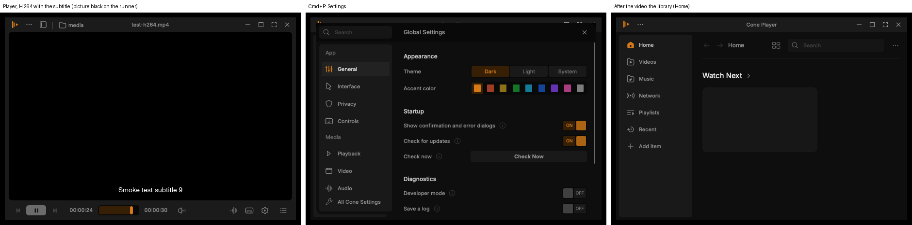

# macOS experimental build (branch wip/macos-build)

Branch `wip/macos-build`, made from `origin/wip/next-test`. Draft pull request into `wip/next-test`. CI only: no change to Cone's code, nothing released. **Experimental:** the PC session or StickyGonzales decide if and when a macOS build is ever offered to anyone.

## What it is
- **Cone Player.app** (the public profile, Cone's redesign) in a `.dmg`, for **Apple Silicon** Macs (M1 and later), macOS 12 or later.
- Built on GitHub's macOS runners by `build-macos.yml`; an **Intel** build is one checkbox away (Actions > build-macos > Run workflow > "Also build for Intel Macs", once the workflow is on the default branch). It is not built on every run, since it doubles the build time.
- **Signed ad hoc** (no Apple developer account): it runs, but macOS asks once before opening it (see "Opening an unsigned app").

## How it is built
| File | What it does |
|---|---|
| `.github/workflows/build-macos.yml` | the build: contribs, Qt, ccache, build, package, artifact, test-builds asset; then the smoke checks |
| `.github/scripts/macos-build.sh` | VLC's own macOS steps (`extras/package/macosx/build.sh`): extra tools, contribs, configure, make, make install |
| `.github/scripts/macos-package.sh` | `Cone Player.app` and the `.dmg` |
| `.github/workflows/smoke-macos.yml` | the smoke checks on a second, clean macOS runner |
| `.github/scripts/macos-smoke.py` | the checks |

**Contribs.** VideoLAN's prebuilt macOS contribs of exactly this source (`artifacts.videolan.org/vlc/macos-arm64/vlc-contrib-aarch64-apple-darwin19-<sha>.tar.zst`), found the same way the Windows build finds its own (`extras/ci/get-contrib-sha.sh`). They hold FFmpeg, the media library, libass, x264/x265, dav1d and the rest. Without a prebuilt set (a contrib change of our own), they are built from source and cached.

**Qt.** VideoLAN's macOS contribs build no Qt (VLC's own macOS app has a native interface), so Qt **6.8.3** (the version Cone bundles on Windows) comes from Qt's own macOS binaries (`aqtinstall`, with Qt Shader Tools for the interface's shaders), cached between runs.

**The interface.** VLC's macOS configure options (`extras/package/macosx/configure.sh`) with `--disable-macosx` (no native interface: Cone's design is its only interface, Decision 63), `--enable-qt`, `--disable-sparkle` (no VLC updater; Cone has its own update notice), `--disable-debug`, `--with-brand=public`. Upstream VLC already runs the Qt interface on macOS (on the main thread, as Cocoa requires: `modules/gui/qt/qt.cpp`) and embeds the video with the "platform" compositor. No core change was needed.

**The app** (VLC.app's layout from `extras/package/macosx/package.mak`, without the native interface):
- `Contents/MacOS/Cone Player` (VLC's macOS binary, `bin/darwinvlc.m`), `vlc-preparser`, `vlc-qt-check`;
- `Contents/Frameworks/`: `libvlc*.dylib`, `plugins/` (every plug-in, flat), the Qt frameworks;
- `Contents/PlugIns/`: Qt's own plugins (Cocoa platform, macOS style, image formats, SVG icons);
- `Contents/Resources/`: `qt.conf`, `qml/` (the Qt Quick modules the interface imports), `share/` (Lua scripts, HRTFs, translations), `cone.icns` (Cone's logo);
- `macdeployqt` copies Qt into the app and rewrites the load paths; the package step fails if anything still loads Qt from the build machine;
- the plug-in cache is generated (`vlc-cache-gen`);
- every binary is signed ad hoc, then the frameworks, then the app; `codesign --verify --deep --strict` must pass.

**Its own settings.** Bundle identifier `io.github.stickygonzales.coneplayer`: VLC's core keeps its files in `~/Library/Preferences/io.github.stickygonzales.coneplayer/` and `~/Library/Application Support/io.github.stickygonzales.coneplayer/` (`src/darwin/dirs.m` names them after the bundle), the interface in `~/Library/Preferences/com.cone.vlc-qt-interface.plist`. An installed VLC is never touched.

**The .dmg:** `Cone-<version>-macos-arm64.dmg`, with `Cone Player.app`, a link to Applications and `COPYING.txt` (the GPL). Plain, without VLC's background picture (it shows VLC's cone).

**Where to download a test build:** the run's artifact `cone-macos-arm64` (one day), or the asset `wip-macos-build--macos-arm64.dmg` on the draft pre-release `test-builds` (redesign/TEST_BUILDS.md). Never a release.

## Smoke checks (after every macOS build)
On a second, clean `macos-15` runner (Apple Silicon), with the Windows and Linux checks' test media (`smoke-media.sh`: 30 s H.264 and HEVC MP4, an SRT file). Each failed check runs once more. Results artifact: `cone-macos-smoke-results` (summary, log, Cone's logs, screenshots).
- **dmg:** it opens, holds the app and the Applications link; the app copies out (`ditto`, as a Finder drag).
- **Signature:** `codesign --verify --deep --strict` passes; the name and the bundle identifier are Cone's.
- **Gatekeeper** (information only): `spctl` rejects it, as every app without a Developer ID; the reason testers open it once with right-click > Open.
- **Two sessions (H.264, HEVC):**
  - the main window appears (CoreGraphics' window list);
  - the playback time advances (VLC's cli interface on a Unix socket);
  - H.264 only: the subtitle file loads (`strack`); **Cmd+P** opens Settings and **Escape** closes it (real key events; the dialog is looked for in the app's accessibility tree when the runner allows this process to read it, otherwise the middle of the window must change and change back);
  - **Cmd+Q** quits in under 3 s (HEVC: a quit the watchdog ends is a warning, as on Windows and Linux);
  - no "cannot load plug-in" line in Cone's log.
- **Settings folders:** Cone's own, VLC's untouched.

What a runner cannot check: picture quality, sound (VLC's dummy audio output), real mouse use of the controls (there is no accessibility access to drive the interface the way the Windows and Linux checks do), Retina scaling on a real display, and Gatekeeper's first-open prompt.

## Results
Smoke checks on GitHub's `macos-15` runner (Apple Silicon, macOS 15.8, a virtual machine), the last runs:

| Check | Result |
|---|---|
| dmg opens, holds the app, the Applications link and COPYING.txt; the app copies out | pass |
| ad-hoc signature verifies (`codesign --verify --deep --strict`); bundle `io.github.stickygonzales.coneplayer`, "Cone Player" | pass |
| Gatekeeper | rejected, as expected for an app without a Developer ID (information) |
| main window | pass, 1.1 to 2.3 s |
| H.264 and HEVC: the playback time advances | pass, both |
| subtitle file loads | pass |
| Cmd+P opens Settings | the dialog opened in runs 6 and 7 (screenshots); see "Runs" for the check itself |
| Cmd+Q | pass, under 3 s |
| every plug-in loads (388) | pass; the plug-in cache is current (no "stale plugins cache" line since run 7) |
| own settings folders, VLC's untouched | pass |
| picture (information) | black in the middle of the video, with hardware **and** software decoding; the subtitles and the interface draw |



## What works, what doesn't
**Works (on the runner):**
- Cone's redesign as the interface: top bar, control bar with the seek bar, the subtitle, Settings (Global Settings: theme, accent, startup, diagnostics), the library's Home page.
- Playback of H.264 and HEVC (time advances), external subtitles, quitting, every plug-in, Cone's own settings folders next to an installed VLC.
- The .dmg, the app bundle, its ad-hoc signature and its Cone icon.

**Not known yet / to check on a real Mac:**
1. **The video picture.** On the runner it stays black (VLC's macOS video output `samplebufferdisplay`, embedded by the Qt interface's "platform" compositor), also with software decoding, while the subtitles drawn into the same video show. The runner is a virtual machine with a paravirtual GPU (Qt also could not create an OpenGL context there), so this is most likely the runner. **The first thing a tester checks.**
2. **Escape in Settings** and keyboard shortcuts in general: the runner delivers synthetic keys unreliably to Qt's window (the first Cmd+P after the local network prompt was lost; Escape did not close Settings in one run).
3. **The local network prompt:** macOS asks once whether Cone may find devices on the local network (VLC's UPnP / Bonjour discovery for the Network view); Info.plist now gives the reason. Declining it only empties the Network view.
4. **The update notice:** Settings shows "Check for updates" On. Cone's checker looks at the Windows / Linux releases; there is no macOS release, so a Mac build should not point to one. Left as is in this experimental build (a code change, not CI); to be decided before any macOS release.
5. **Not built:** Intel (x86_64) on every run (one checkbox on a manual run, untested), Sparkle (VLC's macOS updater), VLC's native macOS interface (Cone's design is the only interface), the fancy .dmg background (VLC's shows VLC's cone).

## Opening an unsigned app (for testers)
Cone Player for macOS has no Apple Developer ID, so macOS says it "cannot be opened because Apple cannot check it for malicious software" the first time. Either way below works once; after that it opens normally.

**Right-click > Open (easiest):**
1. Open the `.dmg` and drag **Cone Player** onto **Applications**.
2. In Applications, **right-click** (or Control-click) **Cone Player** and choose **Open**.
3. In the warning, click **Open**.
   - macOS 15 (Sequoia) and later: if the warning has only **Done** / **Move to Trash**, click **Done**, then go to **System Settings > Privacy & Security**, scroll down to "Cone Player was blocked", click **Open Anyway**, and confirm with your password.

**Terminal (one command):** removes the download's quarantine flag from the app:
```
xattr -dr com.apple.quarantine "/Applications/Cone Player.app"
```

## Test list for a volunteer tester
Any Apple Silicon Mac with macOS 12 or later. Note the macOS version and the Mac model; for each step, "works" or what happened (a screenshot helps).
1. **Install:** open the .dmg, drag Cone Player to Applications, open it (right-click > Open). Does it start, and does the window look like the screenshots in the README (dark theme, top bar, control bar)?
2. **Play, the picture first:** open an MP4 (H.264) and an MKV (HEVC / H.265) by dragging each onto the window and with the "..." menu > Open File. **Do you see the picture** (the runner shows it black)? Sound OK? Pause, seek (click and drag the seek bar), volume, mute.
3. **Subtitles:** a video with an .srt next to it (same name): do the subtitles show? Switch them with the subtitle button.
4. **Fullscreen:** the fullscreen button and F, Escape back; do the bars show and hide on mouse moves?
5. **Settings:** Cmd+P (and the gear > Settings): does the Settings dialog open, does **Escape** close it, can you change the theme and the accent color, and are they kept after quitting and opening again?
6. **Queue and library:** add a folder of videos; the queue sidebar; Next / Previous.
7. **Keyboard:** Space, arrows, M, F, Cmd+Q. (macOS uses Cmd where Windows uses Ctrl.)
8. **Quit:** Cmd+Q quits within a few seconds; nothing left in the Dock.
9. **Next to VLC:** if VLC is installed, does it still open with its own settings?
10. **Retina and a second display:** is the text sharp; does moving the window to another display work?
11. **Anything odd:** crashes (macOS shows a report: copy its first 40 lines), freezes, missing icons, text cut off.

## Runs
| Run | Head | What it showed / what changed |
|---|---|---|
| build-macos #1 | 0477d8adb2 | bootstrap failed: Homebrew's folder (with python3) on the build PATH made extras/tools take Homebrew's autotools and pkg-config → Homebrew kept off the PATH |
| #2 | acaf70691b | VLC compiled; the ncurses plug-in's link lost the system libraries: VideoLAN's prebuilt contribs name their build machine's SDK (MacOSX26.2.sdk) in their .pc / .la files → pointed at the runner's SDK |
| #3 | 21d7718077 | **the whole build passed** (Qt interface, 388 plug-ins); packaging: `bin/vlc-cache-gen` is libtool's wrapper script, macdeployqt copied QtSql's database drivers → the installed generator, no SQL drivers |
| #4 | 905d859d99 | signing failed: `plugins.dat` (data) unsigned under Contents/Frameworks → signed inside out, as `extras/package/macosx/codesign.sh` |
| #5 | 3b86520509 | **build, app, signature and .dmg green** (97 MB); first smoke run: window, H.264, HEVC, subtitles, Cmd+Q, plug-ins, own folders pass; Settings failed (the local network prompt held the keyboard); "stale plugins cache" (signing changed the plug-ins after the cache) |
| #6 | cd3ba554cb | cache made after signing; prompt dismissed; Settings opened (screenshot) but Qt's content is not in the runner's accessibility tree; cache still stale |
| #7 | 544027e979 | `cp -R` into the .dmg did not keep the files' times (VLC checks them to the second) → `ditto`; cache current; Settings opened in the picture, Escape did not close it |
| #8 | 22e9f4c8e4 | the 30 s test video had ended before the Settings check (Cone on its Home page) → the video repeats (`--input-repeat=50`, as on Linux) |
| #9 | a559a4a7ca | see the PR |
