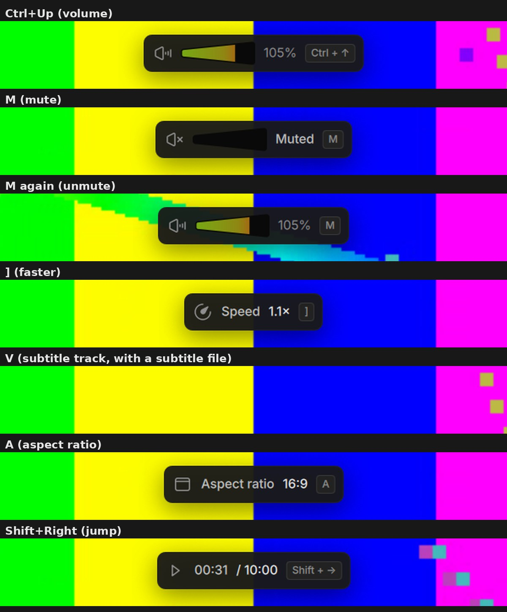

# Cone's on-screen messages (branch wip/osd-cone-style)

Branch `wip/osd-cone-style`, made from `origin/wip/next-test`. Draft pull request into `wip/next-test`. Cone build only (`VLC_BRAND_PUBLIC`); the vlc profile is unchanged.

**Contents:**
- the interface: `modules/gui/qt`;
- a small core hook (Decision 27): `src/video_output/video_text.c`, `video_widgets.c`, `src/player/player.c`;
- the design, chosen by StickyGonzales over rounds 4 to 7 on PR #81: `redesign/OSD_INVENTORY.md` "Final style", and the mockups `mockups/osd/OSD_final_closeup.jpg` and `OSD_final_all_messages.jpg`.

## What it does
- **Instead of VLC's text:** VLC's white outlined text at the top right of the video is replaced by Cone's own message. It is a 44 px box like the control bar's parts:
  - radius 10, BG/A3 Transparent, the bar's 1 px Divider/Dim edge and Figma's shadow;
  - a plain icon, the name, the value;
  - the key that caused it, in a small key cap;
  - for Volume and Muted, the control bar's own volume cone (the VolumeCone shader, read only).
- **Place:** top center, 16 px under the top bar's place, whether the bars show or not. So it never moves, never sits under the top bar, and is far from the Up Next card (bottom right). A quarter bigger in fullscreen.
- **Motion:** fades in over 120 ms, stays for "Show feedback for" (Settings > Subtitles > On-Screen Messages, 2.75 s by default), fades out over 200 ms. A new message changes the content in place.
- **Display only:** it takes no input.
- **VLC's sliders are never drawn:** neither the position slider (#102) nor the volume slider. The message shows the volume level.
- **Every message of the inventory** is sorted into icon, name and value (`player/rd_osd_parse.cpp`, unit test 37 of 37):
  - volume, muted, speed ("1.5x"), delays ("+50 ms"), tracks ("Subtitles English", N/A becomes "Off");
  - aspect ratio, crop, zoom, shuffle, loop, deinterlace, sub sync, audio device, program, projection;
  - chapters (counted from 1), next / previous, the seek time ("00:12:40 / 00:42:10"), recording, snapshot ("Snapshot saved", the file name);
  - pause / resume ("Paused", "Playing");
  - a text it does not know: shown as it is, with the info icon.
- **The interface's own notifications** (interface scale, Minimal View, bookmark added) use the same message in the player, instead of the floating notification.

## How it works
| Part | File |
|---|---|
| The interface creates `cone-osd` on the libvlc object and listens on it; on exit it removes it | `player/rd_osd.cpp` (`RdOsd`, singleton in VLC.Player) |
| A message: when `cone-osd` exists, the core hands over the text and the key ("msg", text, key, separated by 0x1f) instead of drawing it; the "osd" option ("Show feedback for shortcuts") still turns all of them off | `src/video_output/video_text.c` |
| Play / pause / mute icons are handed over ("icon", name, key); the sliders are not drawn | `src/video_output/video_widgets.c` |
| No play state message when a file starts (the top bar names it); "Playing" shows for a resume | `src/player/player.c` |
| Sorting the texts, in their translated form (VLC's catalog) and in English | `player/rd_osd_parse.cpp`, `tests/test_rd_osd_parse.cpp` |
| The message | `player/qml/RdOsdMessage.qml`, placed in `player/qml/Player.qml` |
| The muted speaker icon (the speaker with a cross; the design has none) | `pixmaps/redesign/volume_value-muted.svg` |

- **Without the Qt interface** (`-I dummy`, cli only), nobody creates `cone-osd`, and VLC draws its messages as before.
- **Not handed over:** the media title at start (off by default, Decision 69) and the EPG panel keep VLC's drawing.
- **Library view:** while the library is shown instead of the player, a message (e.g. a volume key) is not shown.

## Checks
- **Unit test** `test_rd_osd_parse`: 37 of 37, compiled and run locally against Qt 6.
- `qmlcheck.py`: errors 1 (the known HighResolutionTimeWidget stub limit), crashed 0.
- `buildlists.py`: 0 problems. `privacycheck.py`: 0 problems.
- **New smoke check:** during playback, ] (faster) shows "On-screen message" with "Speed ..." and it goes away again; = puts the speed back for the next checks. Not a volume key: the smoke runs have no working audio output (adummy on Linux, no audio device on the Windows runner), so the volume has no value and a volume key shows nothing (the first runs #81 and #179 failed on exactly that).
  - Linux: `check_osd`, through AT-SPI.
  - Windows: `Check-Osd`, through UI Automation, on the zip's H.264 and HEVC sessions.

## Runs
| Run | Head | Result |
|---|---|---|
| build-linux #81 (run 41543413846) | fb67ed8ed8 | red: only the new check (Ctrl+Up shows nothing without an audio output); build and every other check green |
| build-windows #179 (run 41543418682) | fb67ed8ed8 | red: the same check; build and every other check green |
| build-linux #84 (run 41556887044) | 7351bfc7ce | green, smoke included ("a key shows Cone's on-screen message" passes) |
| build-windows #183 (run 41556882141) | 7351bfc7ce | red in the check only: the message was found, but its text read as empty (Qt reports the description as UIA's FullDescription, not HelpText); the check now reads FullDescription |
| build-windows #185 (run 41561915405) | 1b795dcd59 | red in the check only: the text still read as empty through FullDescription and the inner names; Qt's UI Automation bridge does not expose this message's description. The Windows check now needs the message to show and go (and any text it exposes to be the speed); the text is checked on Linux |
| build-windows (rerun) | the message shows and goes | running |

## Sandbox (build #81, Linux, Xvfb, a real audio output)

- Volume, Muted, unmute, Speed, Subtitles, Aspect ratio and a jump each show their box at the top center, with the key cap; no VLC text, no slider.
- No QML warning from RdOsdMessage.
- Turning subtitles off (V past the last track) and B with only one audio track show no message: VLC 4's core sends a track message only when a track is selected (src/player/osd.c), the same as before.

## Windows retest (PC session)
Build: the build-windows run of this branch (or `gh workflow run build-windows.yml --ref wip/osd-cone-style`), Cone (portable), a landscape episode.
1. **Volume.** Ctrl+Up and Ctrl+Down: the box at the top center shows the cone filling and "N%", key cap "Ctrl + ↑". No white VLC text, no orange bar on the right in fullscreen. Above 100 % the cone turns orange to red.
2. **Mute.** M: "Muted", empty cone, key cap "M". M again: the volume message.
3. **Speed.** + / - / ]: "Speed 1.5×", no slider.
4. **Tracks.** V and B with several tracks: "Subtitles English", "Audio English". Turning subtitles off shows no message (as in VLC 4).
5. **Seek.** Shift+→ in fullscreen: "00:12:40 / 00:42:10", no orange line at the bottom (#102).
6. **Others.** A (aspect ratio), C (crop), Z (zoom), L (loop), R (shuffle), Shift+N (next chapter), Space (Paused / Playing): each shows its icon, name and value.
7. **Place.** Windowed and fullscreen, with the bars shown and hidden: the box stays at the same place, never under the top bar; in fullscreen it is a little bigger. With the Up Next card on screen, both are readable.
8. **Light theme.** Settings > Style Light: the box turns light.
9. **Setting.** Settings > Subtitles > On-Screen Messages: "Show feedback for" changes how long it stays; turning the messages off shows none.
10. **Interface scale.** Ctrl+= in the player: "Interface scale 125%" in the same box.
11. **Snapshot.** Shift+S: "Snapshot saved" with the file name.
