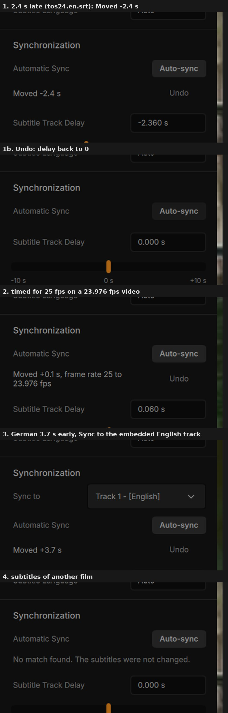
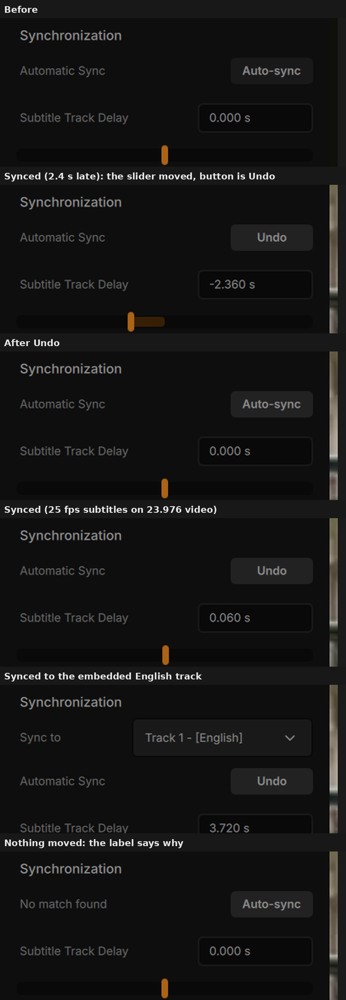

# Automatic subtitle sync (Cone build)

Branch `wip/subtitle-auto-sync`, made from `origin/wip/next-test`. Draft pull request into `wip/next-test`. Owner: web session.

## 1. What it does
- **Where:** Settings sidebar > Subtitles > Synchronization, above "Subtitle Track Delay".
  - **One row** (StickyGonzales: the first version, with a result line under the button, was too cluttered).
    - **Label:** "Automatic Sync", and "Analyzing N %" while it works. A move is shown by the sliders below, not by text (StickyGonzales): the delay slider (and Subtitle Speed, for a frame-rate fix) moves, and the label stays "Automatic Sync". Only when nothing moved does the label say why: "Already in sync", "No match found", or a short reason ("Needs text subtitles", "No audio to sync to").
    - **Button:** **Auto-sync**, **Cancel** while it analyses, and **Undo** after a move. Undo puts back the delay and the subtitle speed from before the first sync of this file.
    - The full sentence ("Moved -1.0 s, frame rate 25 to 23.976 fps", "No match found. The subtitles were not changed.") is the button's accessible description, and the automatic sync's notification.
    - The delay box and the Subtitle Speed slider below show the new values.
  - **Sync to** dropdown above it, shown only when the file has another subtitle track: "Speech in the audio" (the default) or one of the other tracks, for example an in-sync embedded English track.
- **What it changes:** only Cone's existing controls. The **subtitle delay** (the "Subtitle Track Delay" slider moves with it), and for an external file timed for another frame rate, the **subtitle speed** ("Subtitle Speed", VLC's `sub-fps`). No core change.
- **Settings > Subtitles > OpenSubtitles > "Auto-sync downloaded subtitles"** (off by default; needs the OpenSubtitles API key). A file just downloaded from OpenSubtitles for the video playing is synced to the speech as soon as it is selected. The outcome shows in the player's notification above the control bar ("Subtitles auto-synced: Moved +2.4 s"); Undo is in the sidebar. This covers both downloads: the Add Subtitles dialog, and an episode of a folder whose rule downloads from OpenSubtitles. A file added before (from the store) is never re-synced on later plays.
- **Cone build only** (`Brand.isPublic`): the vlc profile shows neither the rows nor the setting.

## 2. License check (alass, ffsubsync)
| | License | Language | Approach |
|---|---|---|---|
| alass | GPL-3.0 | Rust | voice activity detection (WebRTC VAD), then the best alignment of the subtitle lines with "splits" (parts shifted separately), and a frame-rate search |
| ffsubsync | MIT | Python | voice activity detection (WebRTC VAD or auditok), the speech and the lines as binary signals, cross-correlation by FFT for the best constant offset, a fixed list of frame-rate ratios |

- **Cone's licenses:** VLC's core is LGPL-2.1-or-later, its modules LGPL-2.1-or-later or GPL-2.0-or-later, and the Qt interface (where this lives) GPL-2.0-or-later. A Cone binary is distributed under the GPL-2.0-or-later.
- **Is alass compatible?** Legally yes: thanks to "or later", GPL-2.0-or-later and LGPL-2.1-or-later code can be combined with GPL-3.0 code. But the combined program would then have to be distributed under the GPL-3.0 only, which changes Cone's license terms for everyone. alass is also written in Rust, and VideoLAN's build images and contribs have no Rust toolchain.
- **Decision:** our own implementation of the same approach, written for Cone, in C++ (`player/rd_sync_math.cpp`). **No code of alass or ffsubsync is used or translated.** Only the published idea is shared (speech detection, then a cross-correlation of the two timelines, then a frame-rate list), and an idea is not covered by copyright. Cone stays GPL-2.0-or-later. Not taken from alass: split alignment (a track with a cut scene or ad break inside). See section 7.

## 3. The approach (`player/rd_sync_math.hpp/.cpp`)
1. **Loudness per frame:** the audio, downmixed to mono, in 20 ms frames, overall and in the voice band (second-order Butterworth high pass at 250 Hz and low pass at 3.5 kHz).
2. **Speech per frame:** speech rises and falls with its syllables, about 4 a second, while music, ambience and effects hold their level. So the signal is how far the voice-band loudness swings from its half-second average, itself averaged over half a second. It is scaled to 0 (the file's median swing) and 1 (its 95th percentile).
   - Measured on Tears of Steel (12 min, full film score): plain voice-band loudness correlates 0.11 with where the subtitles are. The swing correlates 0.56. Also tried and weaker: spectral flux 0.43, pitch periodicity 0.22, spectral flatness -0.02.
3. **Lines:** 1 in the frames a line is shown, 0 elsewhere.
4. **Best shift:** both signals less their mean, cross-correlated by FFT (own radix-2 FFT), the peak searched within ±5 minutes. The peak's **confidence** is how many standard deviations it stands above the other shifts. A match needs **5.0**.
   - Measured on Tears of Steel: real matches 7.3 to 7.5 against the speech, 10.5 against another track; time-reversed lines and 8 sets of random lines (negative controls) 2.8 to 3.2.
5. **Frame rate:** the same search with the lines' times multiplied by 25/23.976, 23.976/25, 24/23.976, 23.976/24, 25/24 and 24/25. A factor is taken only when its peak is confident and scores 8 % better than the unchanged timing. Only for an external file (VLC rescales external files only) and when the video's frame rate is known.
6. **Speed (measured):** once the audio is read, the search takes about 0.2 s for a 12-minute film, and 0.7 s for a 2-hour film with the frame-rate search (0.16 s offset only). Reading the file is the long part (section 4).

## 4. Reading the file (`player/rd_sync_scanner.hpp/.cpp`)
- One read of the played file in a background thread at low priority, while it plays: its own demuxer and the audio track's decoder, as the waveform seek bar's scanner does. Video packets are dropped undecoded.
- In the same read, the **embedded text subtitle tracks** (SRT, ASS, tx3g, WebVTT, TTML) give their lines' times from their packets, without decoding. A line without a length lasts until the next one, at most 4 s.
- **External files** are parsed with the subtitle timeline's parser (SRT, WebVTT, ASS/SSA). With "Sync to" another external file, nothing is read from the video.
- **Audio track:** the one selected for playback (an external audio file: the video's first).
- **Limits:** a 240 s time budget; Cancel and a new file stop it at once (VLC interrupt).

## 5. Applying it (`player/rd_sub_sync.hpp/.cpp`, `RdSubSync`)
- **Delay:** set to the delay found (replacing the current one). The result shows the change from the delay before.
- **Frame rate:** VLC multiplies an external file's times by (video fps / subtitle speed) (`src/input/input.c` RequestSubRate, `modules/demux/subtitle.c`). So the speed is set to video fps / factor.
  - For a file timed for 25 fps on a 23.976 fps video, the "Subtitle Speed" slider then shows 22.993 fps. That is VLC's own meaning of the value; the result line names the pair ("frame rate 25 to 23.976 fps").
  - With no factor needed, a speed set before is taken back to the file's own timing, since the lines were measured at that timing.
- **Undo:** puts back the delay and speed from before the first sync of this file, also after a second sync.
- **A new file:** VLC keeps the subtitle speed for the next file, so a frame-rate fix is taken back when the file changes (unless the user changed it since). The delay is per file in VLC anyway.
- **Stale results:** a result is dropped when the file or the selected track changed during the read.
- **Not available:**
  - no subtitle track selected, or a stream that is not a local file (the button is disabled);
  - a bitmap track (DVD, PGS): "Auto-sync needs a text subtitle track (SRT, ASS, WebVTT)."

## 6. Tests
- **Unit test** `test_rd_sync_math` (`tests/test_rd_sync_math.cpp`, autotools `TESTS` and meson suite `qt`): 31 of 31 pass, in about 1 s. It uses generated audio: syllable-like noise bursts where the lines are, steady chords and noise everywhere.
  - Constant offsets +2.4 s, -7.3 s and +45 s: found within 40 ms.
  - Lines timed for 25 fps on 23.976 fps: factor 25/23.976, delay within 60 ms. The reverse (23.976 on 25) plus 1.5 s: found.
  - Another track as the reference: +3.7 s, and 25 vs 23.976 with -1.2 s: found.
  - Unrelated lines (3 sets), silence and no lines: no match.
- **Real film (offline harness on the same code, Tears of Steel audio, its English subtitles):**

| Lines given | Found |
|---|---|
| in sync | +20 ms |
| 2.4 s late | delay -2.38 s |
| 7.3 s early | +7.32 s |
| 45 s late | -44.98 s |
| timed for 25 fps (x 23.976/25) | factor 25/23.976, +40 ms |
| x 23.976/25 and 1.5 s late | factor 25/23.976, -1.54 s |
| timed for 23.976 on 25 (x 25/23.976) | factor 23.976/25, +20 ms |
| x 24/25 and 3 s early | factor 25/24 (1.0417), +3.16 s |
| German track against the English track, 3.7 s early | +3.70 s (confidence 10.5) |

- **Linux sandbox on build-linux #87** (Xvfb + openbox, the CI-built tarball, AT-SPI clicks: Playback Settings > Subtitles > Auto-sync). Test media made from Tears of Steel (12 min, CC BY 3.0 Blender Foundation; 426x240 H.264 + AAC; not committed):

| Case | Shown | Log (`subtitle sync`) | Read |
|---|---|---|---|
| 1. 24 fps video, its English SRT 2.4 s late | "Moved -2.4 s", Undo; delay -2.360 s | match, delay -2360 ms, confidence 7.4 | 4.1 s (first run), 2.1 s |
| 1b. Undo | delay back to 0.000 s, the result line goes | | |
| 2. 23.976 fps video, SRT timed for 25 fps (x 23.976/25) | "Moved +0.1 s, frame rate 25 to 23.976 fps"; delay 0.060 s | match, delay 60 ms, scale 1.04271 | 3.9 s |
| 3. MKV with an in-sync embedded English track; external German SRT 3.7 s early; Sync to "Track 1 - [English]" | "Moved +3.7 s"; delay 3.720 s | match, delay 3720 ms, confidence 11.0 | 1.4 s (no audio decoded) |
| 4. 24 fps video alone in its folder, SRT of another film | "No match found. The subtitles were not changed."; delay stays 0 | no match, confidence 3.3 | 2.1 s |

- **Found while testing:** VLC also loads a subtitle file named like the video from its folder (`tos24.en.srt` next to `tos24.mkv`), and selects it. Auto-sync then works on that track, as it should (case 4 runs from its own folder).
- **One-row layout on build-linux #89** (same four cases, same results: -2.36 s, factor 25/23.976 with +60 ms, +3.72 s from the English track, no match). Undo is the button itself, exposed to AT-SPI as "Undo Auto-sync"; clicking it puts the delay back to 0.000 s and the row back to "Automatic Sync".

- **Changed after the sandbox:** the result line under the button (shots above) is gone. The outcome is now the row's label and Undo is the button, which also fixes a found bug: the result line and its Undo were missing from the accessibility tree (AT-SPI). The Auto-sync row was always exposed.
- `qmlcheck.py`: errors 1 (the known HighResolutionTimeWidget stub limit), crashed 0. `buildlists.py`: 0 problems. `privacycheck.py`: 0 problems. The new and changed C++ files (scanner, controller, Add Subtitles) compile cleanly with `-Wall -Wextra` against the system's Qt 6 headers. mainui.cpp could not be checked this way (it needs a header generated by the build); the CI build covers it.

## 6b. Independent review (fixed)
A fresh agent reviewed the whole diff. It found no deadlock, lifetime or ownership problem. It confirmed the delay sign and the subtitle-speed math, and ran the unit test (31/31). It found four real bugs, all fixed:
1. **MPEG-TS / M2TS time base:** times were counted from the stream's first timestamp instead of its "normal time" (its first clock reference), which VLC uses for external subtitles (src/input/es_out.c). A .ts file would have got a delay off by up to its start time. The read now asks the demuxer for it (DEMUX_GET_NORMAL_TIME).
2. **Subtitle speed on the next file:** taking back a frame-rate fix on a file change went through PlayerController, which ignores changes while it switches media. It is now set directly on the player.
3. **Empty MP4 samples:** MP4 fills the gaps between lines with empty tx3g / WebVTT samples (and some muxers send empty SubRip lines). They were counted as lines; they are skipped now.
4. **Auto-sync of a download:** it could start before VLC listed the file on the media, and then fail with "could not be read". It now waits for the file as well.
- **Also:** a read stopped by the time budget now says "The file took too long to read."

## 7. Limits
- **One offset for the whole track:** a track with a cut scene or an ad break inside (split alignment, alass's speciality) is moved by its best single offset.
- **Little speech:** a file with very little speech, or dialogue buried under constant loud music, may give "No match found". Nothing is changed then.
- **Frame-rate factors:** only for external files (VLC's subtitle speed rescales external files only), and only the six 23.976 / 24 / 25 factors.
- **Frame rate unknown to the demuxer:** VLC only applies the subtitle speed when the file's demuxer reports a frame rate. The factor is searched with the video track's rate; a file whose demuxer reports none would show the result without the stretch taking effect. Rare (raw streams).
- **Unstable track ids:** a track whose id VLC made up ("spu/auto/N") cannot be matched to its packets: "Auto-sync needs a text subtitle track". Rare.

## Runs
| Run | Head | Result |
|---|---|---|
| build-linux #85 / build-windows #187 | fd562cc469 | cancelled (review fixes came first) |
| build-linux #86 (run 41688840222) | 1e2cc52c89 | red: link error, vlc_player_GetAssociatedSubsFPS is not exported from libvlccore; build-windows on the same head cancelled |
| build-linux #87 (run 41693396275) | 80307e2b3b | green, smoke included; the sandbox tests above |
| build-windows #189 (run 41693402841) | 80307e2b3b | superseded by the accessibility fix |
| build-linux, build-windows (4a01e7b99f) | the accessibility fix | superseded by the one-row layout, cancelled |
| build-linux #89 (run 41703941299) | 6fe216ee38 | green, smoke included; sandbox below |
| build-windows #191 (run 41703946938) | 6fe216ee38 | green, smoke included |

## Windows retest (PC session)
Build: the build-windows run of this branch (or `gh workflow run build-windows.yml --ref wip/subtitle-auto-sync`), Cone (portable). Use an episode or film with dialogue, plus its matching .srt.
1. **Constant offset.** Shift the .srt by 2.4 s (any subtitle editor, or VLC's own delay, then Save). Open the video with it, open the sidebar > Subtitles, and click Auto-sync.
   - Expected: "Analyzing N %" counts up while the video keeps playing smoothly; the result is about "Moved -2.4 s"; the delay slider shows about -2.4 s; the lines now match the speech.
   - Click Undo: the delay goes back to 0.
2. **Frame rate.** A 23.976 fps video with an .srt timed for 25 fps (PAL), or an .srt with every time multiplied by 0.959. Auto-sync.
   - Expected: "Moved ... s, frame rate 25 to 23.976 fps"; the lines match both at the start and at the end of the film; Subtitle Speed shows 22.993 fps.
   - Undo: both go back. Play the next file: its subtitle speed is back to normal.
3. **Reference track.** An .mkv with an embedded English track that is in sync, plus an external file in another language that is out of sync. Select the external file, set "Sync to" to the English track, click Auto-sync: the external file moves to match.
4. **No match.** The .srt of another film: "No match found. The subtitles were not changed.", nothing moves.
5. **Cancel.** On a long film, click Cancel while it analyses: it stops at once and nothing changes. Playing another file during a sync also stops it.
6. **Download.** With an OpenSubtitles API key, turn on Settings > Subtitles > "Auto-sync downloaded subtitles". Download subtitles in Add Subtitles: a notification "Subtitles auto-synced: Moved ..." (or "... are in sync") appears above the control bar, and Undo is in the sidebar. With the setting off, nothing is synced.
7. **Performance.** During the analysis: no stutter in playback and no UI lag (it runs at low priority). Analysis time for a 45-minute episode and for a 2-hour film: note both.
