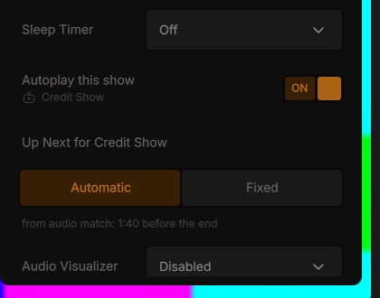
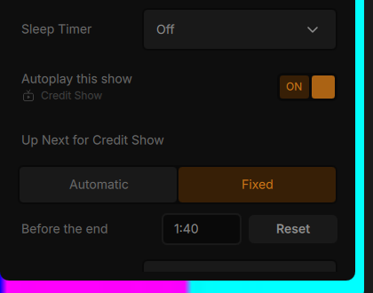

# Up Next: where the credits start (branch wip/up-next-credits-scan)

Branch `wip/up-next-credits-scan`, made from `origin/wip/next-test`. Draft pull request into `wip/next-test`. Cone extra (Decision 71, part of Autoplay next episode). It only works while Up Next is on (Cone build; Up Next is off in the vlc profile), and it only touches the interface module (`modules/gui/qt`): no core change, no new contrib. The plan's summary is `redesign/UP_NEXT_PLAN.md` section 5.5.

## 0. What the user sees

| Before | Now |
|---|---|
| The learned point moved later every episode (the card's own Next button was learned). | Clicks on the card are never learned. The point only moves when the user moves on **before** the card shows (earlier) or **after Cancel** (later). |
| The card point came from a chapter, the learned point or the setting, fine-tuned by subtitles. | It also comes from the credits music matched across the show's episodes, black frames and the subtitles, plus a per-show **Fixed** time. |
| Nothing in the sidebar said where the card would show. | Sidebar > Playback, under "Autoplay this show": **Up Next for <show>** with **Automatic / Fixed**. Automatic names the point in use and its source ("from audio match: 1:40 before the end"). Fixed shows "Before the end [1:40] [Reset]". |

## 1. Drift fix (learning)

`rdcredits::learnedLead(Move)` in `player/rd_credits_point.cpp`, called from `RdUpNext::learnCreditsPoint`. A move is the episode playing changing to the next episode of the show. It is learned only inside the credits window and before the countdown:

| The move | Learned? |
|---|---|
| The card's **Next episode** button (or its picture) | Never |
| Next (key, button, queue, library) inside the window **before the card showed** | Yes, if earlier than the saved point (or none is saved) |
| **Cancel** on the card, then a move to the next episode later in the same episode | Yes, later, to that move |
| The card was showing and the user moved on some other way (no Cancel) | No |
| The countdown, the episode simply ending, a move outside the window, Previous, another episode | No |

After Cancel the autoplay item leaves the queue, as before (#87). Next then has nothing to go to, so the "later move" is the next episode opened any other way: the library, the queue, or the file. The card's behaviour itself is unchanged.

## 2. Per-show setting

- **Where:** `PlaybackSettingsPage.qml`, right under "Autoplay this show". Shown only while a show plays.
- **Automatic** shows the point used now and its source:
  - "from audio match"
  - "from the credits chapter"
  - "from subtitles, black frames and your past choices"
  - "from your past choices"
  - "from the end of the dialogue"
  - "from the setting"
- **Fixed** is pre-filled with the current point (m:ss; "1:52", "112" and "1 52" are all read).
  - It always wins for that show and all its seasons. The key is the show's root folder, the same one the answers and learned points use.
  - It is still held inside the credits window, so the card never shows mid-episode.
- **Reset**, or picking Automatic, drops it.
- **Stored in** `rd-shows.json` as `"creditsScan": {"shows": {"<root>": {"fixedLeadMs": ...}}}`. Settings > Playback > Episodes > Forget all clears it, and the count there includes it.

## 3. Audio fingerprint (credits music across episodes)

**What I looked at**
- **Jellyfin's Intro Skipper** (GPL-3.0):
  - it fingerprints the audio of two episodes with Chromaprint;
  - it compares the two fingerprints at every shift, counting matching bits;
  - it takes the longest stretch of matching values (at least 15 s, with short gaps allowed) as the shared intro or credits.
  - Only the approach is used here; no code was copied.
- **Chromaprint in VLC's contribs:** `contrib/src/chromaprint` (1.6.0), LGPL-2.1-or-later, compatible with Cone's GPL-2.0-or-later.
  - It needs FFmpeg built as its FFT backend.
  - It is only used by the `stream_out_chromaprint` module, which is not linked into the Qt interface.
  - It is not in the Linux build image.
  - Using it would mean a new contrib dependency of the interface on three platforms, for one FFT.
- **Decision (Claude):** our own lightweight fingerprint in `player/rd_credits_audio.*`, standard library only. It is the same family as Chromaprint and the classic Philips audio fingerprint.

**How it works**
- **Values:** 8 a second. Each is a 32-bit value from 33 log-spaced bands between 300 Hz and 2 kHz.
  - The audio is mono, brought down to about 11 kHz, with a 0.74 s Hann window.
  - A bit is set when the band-to-band loudness difference rises against the previous value.
  - Bands more than 30 dB under the loudest are taken as equally empty, so faint noise decides nothing.
  - Silence gives 0, which never matches.
- **Two values match** when at least 70 % of the bands rising in either rise in both (plain bit errors let any two sparse values match).
- **Two episodes match** where the same music lasts 15 s or more at one shift, with gaps of up to 3.5 s (a sound effect over the music). The start of that stretch in each episode is its credits start.
- **The quick check** looks for the first 10 s of the show's kept music, the first minute of it. Half of those values must match; unrelated audio gets well under 1 %.
- **Cost:** printing 8 minutes of 48 kHz audio takes about 1.6 s of CPU, and matching two endings about 25 ms. Both run on the worker thread.

## 4. Black frames

- **Sampling:**
  - Only the video's key frames are decoded (`avcodec-skip-frame` nonkey, no loop filter, one thread, software).
  - At most 4 samples a second.
  - Each sample is a 48 x 27 grid of the luma plane.
  - A grid point under luma 40 (8-bit; scaled for 10-bit) is dark, and a sample is black when 85 % of the grid is dark.
  - White credit text on black stays black; a normal scene does not.
- **The credits start** (`rdcredits::blackStart`) is the start of the first stretch of 30 s or more (or to the end, at least 15 s) where 90 % of the samples are black.
- Black frames are **never used alone**: a dark scene before the credits would fool them. They count only when they agree with the subtitles or the learned point (section 6).

## 5. Subtitles

- **Sources:**
  - An external subtitle file: the ones VLC loaded, then the files next to the episode or in a Subs folder.
  - Otherwise an embedded text track (SubRip, ASS, tx3g), read in the same pass as the audio, only over the scanned stretch, even when subtitles are off.
  - Picture subtitles are never read.
- **The end of the dialogue** (`rdcredits::dialogueEnd`, unchanged) is the last real dialogue line before a gap of 60 s or more, or before music lines only (♪ ♫ #).
- **Ignored:** credit and ad lines ("subtitles by", "synced by", "downloaded from", web addresses).
- Taking the first such gap keeps a post-credits scene with dialogue from pulling the point to the end.

## 6. Decision order and scan strategy

**Order** (`rdcredits::decide`), always held inside the credits window (the last 8 minutes, or the last 15 % of a shorter episode):
1. The show's Fixed point.
2. A credits chapter.
3. The audio match (full scan or quick check).
4. Subtitles, black frames and the learned point:
   - where two agree within 90 s, the more precise one (subtitles, then black frames, then the learned point);
   - if none agree, the learned point.
5. The setting (the last 30 s / 1 min / 2 min).
   - With nothing else, the end of the dialogue alone may move it by up to 2 minutes. This keeps the card where it showed before for shows the scans never see.

**Which scan an episode gets** (`rdcredits::planScan`, `RdCreditsScans`):

| Situation | Scan |
|---|---|
| The show has no credits music yet (its first two episodes) | **Full**: the credits window (8 minutes), audio, key frames, text subtitles |
| The episode's length is within 5 minutes of the show's usual length (median of the last 9) | **Quick**: audio only, from 1 minute before to 1 minute after where the music is expected (end minus the show's credits length), plus the music's first 10 s |
| The episode's length is more than 5 minutes off (finale, special) | **Full** at once |
| The quick check does not find the music | **Full** in the same job |

- **After every full scan** the show's info is updated: its credits length (from the end), its music (from a pairing), and its usual length.
- **Pairing:** a full scan is matched against up to 3 other full-scanned episodes of the show that have no music yet. A match gives both episodes their credits start and the show its music.

## 7. Performance and safety

| Rule | How |
|---|---|
| Only local video files | `m_path` is empty for anything but a local file; `rdcredits::isScannableVideo` (mkv, mp4, m4v, avi, mov, webm, ts, m2ts, mts, wmv, mpg, mpeg, ogv, flv, 3gp, vob, divx, xvid, asf). Never audio files, streams or network URLs. |
| Only shows with 3+ video files | `RdUpNext::requestCreditsScans`: `isShow` and at least `kMinShowVideos` (3) scannable episodes. A movie on its own and a 2-video folder are never scanned. |
| Only when Up Next is on for the show | No detection while Up Next is off; switching it off stops the scan in progress and drops the queue; a show turned off in the sidebar is not scanned. |
| Separate decoder | `RdCreditsScanner`: its own VLC object, `vlc_stream_NewURL` + `demux_New` + packetizers and decoders (the waveform scanner's pattern), never the player. |
| Background, low priority | One `QThreadPool` thread at `QThread::LowestPriority`. The episode playing first, then the next one, scanned while the current one plays. |
| Light | Key frames only for the picture, one decoder thread (avcodec and dav1d), no hardware decoding. Only the chosen tracks are selected, so demuxers skip the rest. A file without audio stops after 500 packets. |
| Once per file | Results kept per file (path + size + modification time) and per show in `rd-shows.json`, at most 400 files. A failure that may not hold next time (cancelled, over budget, a failing decoder) is skipped for the session only. |
| Seek previews stay fast | The seek bar's hover or drag (`SliderBar.qml` `scrubbing`) pauses the read (`RdUpNext.setSeekBarBusy`); the paused time is not counted in the budget. |
| Battery saver | Windows: `GetSystemPowerStatus` `SystemStatusFlag`. Nothing starts while it is on. Linux and macOS: no check. |
| Quit | `RdUpNext::~RdUpNext` calls `RdCreditsScans::shutdown()` first. It cancels the scan (`vlc_interrupt_kill` on the scan's own interrupt) and drops the queue; the read stops at its next packet. |
| Files never locked | VLC opens files with `FILE_SHARE_READ \| FILE_SHARE_WRITE \| FILE_SHARE_DELETE` on Windows (`src/win32/filesystem.c`); POSIX never locks. An episode can be moved, renamed or deleted during its scan. |
| No conflicts | Nothing changes in playback, the queue, resume positions, Continue Watching, track memory (#99), the card's own behaviour (#87, #95, #101), the media library, OpenSubtitles or hardware decoding (the scan's own decoder only). The existing show data in `rd-shows.json` is reused (same file, same show key), with one new key `"creditsScan"`. |

## 8. Files

| File | What |
|---|---|
| `player/rd_credits_point.*` | Decision order, learning rule, scan plan, black frames (pure, QtCore) |
| `player/rd_credits_audio.*` | Fingerprint, longest match, quick check (pure, standard library) |
| `player/rd_credits_scanner.*` | One read of a stretch in its own demuxer and decoders |
| `player/rd_credits_scans.*` | Queue, worker, cache, show info, JSON |
| `player/rd_up_next.*` | Integration: learning flags, inputs, Fixed, properties, store |
| `player/rd_credits_subtitles.hpp` | `fromFiles()` made public (external files for the full scan) |
| `player/qml/PlaybackSettingsPage.qml` | The "Up Next for <show>" row |
| `player/qml/SliderBar.qml` | Pauses the scans while scrubbing |
| `tests/test_rd_credits_point.cpp`, `tests/test_rd_credits_audio.cpp` | Unit tests |
| `Makefile.am`, `meson.build` | New sources, moc, new test |

## 9. Tests

### Unit tests
- **`test_rd_credits_point` (106 checks, all pass):**
  - the decision order;
  - learning: five card clicks keep the point; an early Next moves it earlier; Cancel then a later Next moves it later;
  - Fixed ignores everything else;
  - a dark scene alone or a post-credits scene alone fools nothing;
  - the end of the dialogue alone moves the setting's point by at most 2 minutes;
  - scan planning: quick within 5 minutes of the usual length, full beyond;
  - scannable extensions;
  - black frames.
- **`test_rd_credits_audio` (17 checks, all pass):**
  - two episodes with the same credits music give its start (±0.5 s);
  - the quick check finds the music 25 s after the expected point, also in a lossy copy;
  - another show's music, silence and a window without the music are never found;
  - credits of 6:30 are matched;
  - a post-credits scene ends the match.

### Linux sandbox (build-linux #94, `cs.py`)
**Media:** generated 55-minute episodes (`make_eps.py`, 160x90, AAC 48 kb/s).
- Each episode has its own sound up to the credits.
- The show's credits melody is the same in every episode; the credits are white text on black.
- Each episode has an SRT with dialogue up to the credits.

| Case | Result |
|---|---|
| E01 and E02: full scans; E02's credits music matched with E01's | pass: E02 3200.5 s (true 3200.3), E01's card point 3200.2 s from the audio match |
| The show saved: credits 99.5 s from the end, 60 s of music, the lengths | pass |
| The sidebar row; Fixed pre-filled with the current point (1:40) | pass (screenshots below) |
| E03, 40 s longer, dialogue after the credits: quick check only | pass: 3240.2 s (true 3240) |
| E04, 2:30 shorter: quick check only | pass: 3050.2 s (true 3050) |
| E05, normal length, credits 100 s longer: the quick check misses, the full scan finds them | pass: 3100.3 s |
| E06, 7 minutes longer (finale): no quick check, a full scan at once | pass: 3620.3 s |
| E07, credits of 6:20: found in the 8-minute scan | pass: 2920.2 s |
| A dark scene (45 s) before E02's credits | black frames point there (2950 s); the audio match wins, the card is at 3200.5 s |
| E03's post-credits dialogue | the end of the dialogue is 3232 s (the last line before the credits), not the post-credits line at 3313 s |
| Next at 3150 s, before the card | learned 148 s before the end (earlier) |
| The card's Next episode button | not learned (unchanged) |
| Cancel on the card, then the next episode at 3270 s | learned 68 s before the end (later) |
| Fixed 0:30 in the store | wins over the audio match (3270 s) |
| A 2-video show folder, a movie alone, mp3 files | never scanned |
| Quit during a scan (paused on the seek bar) | 0.3 s, as without a scan; the log says "cancelled" |
| Rename the episode being scanned | the rename works, the scan finishes |

**Bugs found by the sandbox and fixed:**
- **The quick check never found re-encoded music.** At the true place 40 % of the values match, and the check wanted 50 %. It now wants 25 %; other audio matches 0 %.
- **No margin at the window's edges.** The quick window reads 2 s more at each end, so music starting right at an edge is whole.

 

## 11. Existing features checked (nothing that passed before fails now)
**Smoke runs.**
- Linux smoke (build-linux #92 and #94): 39 of 39 pass, the same set as before. It covers:
  - window and playback time;
  - subtitle file loads;
  - Settings opens;
  - seek bar click;
  - "..." menu in a window and in fullscreen;
  - speed slider drag;
  - pointer hiding (window, paused, fullscreen);
  - VA-API driver path, window class and media controls name;
  - single-instance handoff;
  - quit time;
  - every plug-in loads;
  - tarball settings, install.sh / uninstall.sh;
  - the .deb next to VLC, and its removal.
- Windows smoke (build-windows #195): green on the same checks as before:
  - H.264 and HEVC sessions, fullscreen top bar, menu clicks, speed drag, pointer;
  - quit within 3 s without the watchdog;
  - portable settings;
  - installer install, reinstall shortcuts, uninstall.

**Sandbox.** These still work as before:
- Up Next card at the setting's point on unscanned shows (the 2-video show: 9:00 of 10:00);
- a movie and audio files: no show, no card;
- quit time unchanged (0.3 s with and without a scan);
- the queue's autoplay item and the next episode playing on.

**Not touched.**
- Playback, the queue, resume positions, Continue Watching, track memory (#99), the card's own behaviour (#87, #95, #101), the media library, OpenSubtitles and hardware decoding.
- The scans use their own decoder. They only read `rd-shows.json` and add its new `"creditsScan"` key.

## 13. Merged onto wip/next-test (2026-11-08)
CC PC's Windows test passed (credits detection, Fixed, the sidebar row), but the branch conflicted with #99 (track memory) and #101 (card fixes).
- **#101 was not on `wip/next-test` on GitHub yet** (none of its changes there; probably merged on the PC and not pushed). Its branch `wip/up-next-card-click-fill` is merged in here too, so this PR also carries #101's commits; once the PC pushes its #101 merge they are the same commits and nothing conflicts again.
- **Merges, no rebase** (the commits CC PC tested stay as they were): `863fae43df` (wip/next-test), `3f4fa931f9` (#101's branch).

| File | Conflict | Resolution |
|---|---|---|
| `rd_up_next.hpp` | the credits getters next to `rememberedTracks()` | both kept |
| `rd_up_next.cpp`, show detected | credits scans requested vs saved tracks applied | both, in that order |
| `rd_up_next.cpp`, Forget all | each side cleared its own data | one check and one clear for answers, learned points, track choices and credits scans; the credits card state resets |
| `rd_up_next.cpp`, store load / save | `creditsScan` vs `tracks` in `rd-shows.json` | both read and written (checked: the file holds both after a session) |
| `Makefile.am`, `meson.build` | new sources and tests from both sides | both kept (`buildlists.py`: 0 problems) |
| `linux-smoke.py`, `win64-smoke.ps1` | next-test's first-start / open-in-running checks vs #101's Next-episode check | all run; `Session` takes `first_start`, `repeat` and `subs` |

`rd_up_next.cpp` merged with #101 by itself. In `playNow` ("Next episode" on the card) the three meet and all stay: never learned from the card (#107), the rest of the episode counts as watched, and the switch guard (#101).

**Windows smoke order** (`9a3ced4467`): build-windows #206 failed one check: #101's Next-episode check could not put Cone in front ("not the foreground window"). It now ran after next-test's open-in-running check (a Cone raised by a second start, then ended), after which the runner did not let the next Cone take the foreground. It runs before those two checks now, as on #101's branch where it passed.

**Unit tests** (built against Qt 6 in the sandbox, every `test_rd_*` in `Makefile.am`): 6 of 6 suites, 0 failures. `test_rd_credits_point` 106, `test_rd_credits_audio` 17, `test_rd_show_tracks` 33, `test_rd_episode_parser` 470, `test_rd_sync_math` 31, `test_rd_osd_parse` 37.

**Linux sandbox on build-linux #103** (`3f4fa931f9`):
- **Credits detection** (`cs.py`, the cases of section 9): all pass. E01/E02 full scans and the audio match (3200.5 s, true 3200.3); E01's card point from the audio match; the show saved (credits 99.5 s from the end, music, lengths); the sidebar row and Fixed pre-filled with 1:40 and saved; learning (early Next 148 s, the card's Next not learned, Cancel then later Next 68 s); post-credits dialogue; Fixed 0:30 wins; E03 to E07 quick checks and full scans at the right points (3240, 3050, 3100, 3620, 2920 s); two-episode folder, movie and music never scanned; quit during a scan 0.3 s as without; rename during a scan. Reset in the Fixed row is on screen (screenshot) but the script did not find it by its accessible name; it was not in the earlier sandbox results either and is on the Windows retest list.
- **Track memory** (`tr.py`, `tr_off.py`, the cases of SHOW_TRACKS_NOTES.md): 21 of 21, as before the merge.
- **Sandbox scripts:** two first tries quit at their start (the `series` case): the scripts' `--rc-fake-tty` made VLC's cli read stdin and quit Cone when it ended (the same as the macOS smoke, MACOS_NOTES.md). The scripts now use the socket alone, stdin `/dev/null`. Not a Cone change.

**Runs:** build-linux #103 green, smoke 47 checks (first start, Next episode keeps the next episode playing: 1 -> 2, still playing). build-windows #206 red (the smoke order above), **#207 green** on `9a3ced4467` (smoke included, the Next-episode check passes).

## Windows retest (PC session)
**Build:** the build-windows run of this branch, Cone (portable), with Up Next on.

**Media:** a real show folder with 3 or more episodes of the same series (mkv or mp4) and the same end credits music. A text subtitle file next to some episodes helps.

1. **First two episodes.**
   - Play E01. After a minute, Settings > General > "Save a log" shows "credits full scan" lines for E01 and E02, the second with "credits music matched with another episode".
   - Sidebar > Playback, under "Autoplay this show": "Up Next for <show>", Automatic, "from audio match: m:ss before the end". Seek near the end: the card shows when the credits music starts.
2. **Later episodes.** Play E03 and E04: their log lines say "quick check", found where the credits start. Playback never stutters while E04 is scanned in the background.
3. **Drift fix.**
   - In E03, press Next (key or control bar) inside the credits, before the card: the next card shows that much earlier.
   - Click the card's Next episode several episodes in a row: the point stays the same.
   - Cancel on the card, then open the next episode a bit later: the point moves later to that moment.
4. **Fixed.** Pick Fixed and type 1:30: the card shows 1:30 before the end in every episode of the show, all seasons. Reset goes back to Automatic.
5. **Seek bar.** While an episode is scanned (the first minute of a new show), hover and drag the seek bar: the seek previews stay fast.
6. **Quit.** Quit during a scan (a new show, the first minute): Cone closes as fast as usual, no watchdog.
7. **Rename.** During the first minute of a new show, rename the next episode in Explorer: the rename works.
8. **Never scanned.** A movie alone, a folder with 2 videos, music: no "credits scan" line in the log.
9. **Battery saver.** On a laptop with battery saver on, a new show logs "credits scans wait (battery saver)" and scans nothing.
10. **Forget all.** Settings > Playback > Episodes > Forget all clears the Fixed point and the scan results.

## 10. Review

An independent review found no crash bug. All its findings were fixed except one (commit `cb4b95b038`):
- **The end of the dialogue alone:** it no longer moves the card anywhere in the window. It is limited to 2 minutes around the setting's point, as before.
- **Paused time and transient failures:** paused time is not counted in the budget, and transient failures are not stored.
- **Video decoder trouble:** a failing video decoder keeps the audio result; dav1d is limited to one thread.
- **Pairing:** it refreshes the other episode's card (the episode playing).
- **Fixed point and loading:** a Fixed point set before the store loads keeps the show's scan data.
- **Forget all and Up Next Off:** they drop a result still on its way; Forget all also clears a scan cache with no other data.
- **Files without audio:** they stop after 500 packets.
- **Seeking and edge cases:** a demuxer without a time index seeks by position; a mid-file rate change is skipped; null ES ids are guarded.
- **Seek bars:** several seek bars are counted.

**Accepted:** quit can wait for one read that cannot be interrupted (a seek near the end of a file without an index on a very slow drive). The waveform scanner has the same exposure. The quit watchdog still ends Cone.

## 12. Known limits

- The scan reads the credits window, the last 8 minutes or the last 15 % of a shorter episode (the card's window limit, kept): in a 22-minute episode that is 3.3 minutes.

- AV1 and other codecs outside avcodec decode every frame, on one thread. A very long scan stops at its 120 s budget, is not kept, and is tried again next session.
- The learned "later" move after Cancel needs the next episode opened another way: Next has no item after Cancel, as before.
- Battery saver is only checked on Windows.
- Picture subtitles and burned-in text are never read.
